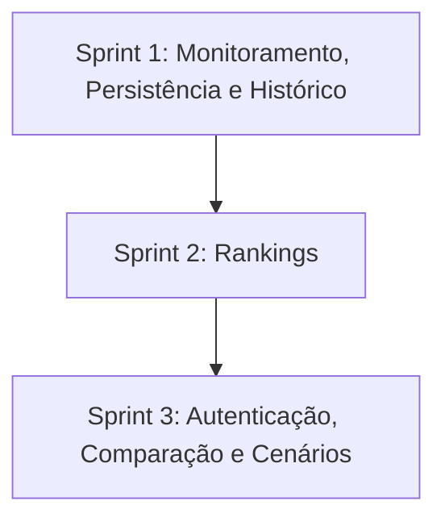

# GreenER

Aplicação web para monitorar métricas de serviços digitais e estimar potência,
consumo energético e emissões de CO₂e conforme a intensidade de carbono regional.
Os resultados são estimativas de um modelo; não substituem medições físicas.

## Índice

- [Descrição do projeto](#descrição-do-projeto)
- [Organização de pastas](#organização-de-pastas)
- [Como executar](#como-executar)
- [Cronograma de evolução](#cronograma-de-evolução)
- [Funcionalidades e estado atual](#funcionalidades-e-estado-atual)
- [Documentação técnica](#documentação-técnica)
- [Sprints](#sprints)

## Descrição do projeto

O backend descobre serviços, consulta CPU, memória, disco e rede, sincroniza
regiões e persiste coletas com estimativas ambientais no PostgreSQL. A interface
React apresenta lista e detalhe com dados simulados enquanto a integração é concluída.

Tecnologias utilizadas: React, TypeScript, Vite, Tailwind CSS, React Router,
Node.js 24, Express, Zod, driver `pg`, PostgreSQL 17 e Docker Compose.
O acesso ao banco utiliza SQL explícito, sem ORM.

## Organização de pastas

Estrutura existente nesta branch; módulos futuros não são apresentados como arquivos implementados.

```text
GreenER/
├── README.md
├── docker-compose.yml
├── backend/
│   ├── arquitetura.md
│   ├── .env.example
│   ├── Dockerfile
│   └── src/
│       ├── app.ts, index.ts, server.ts
│       ├── db/
│       ├── integrations/
│       ├── jobs/
│       ├── modules/        # services, collections, analytics e monitoring
│       ├── scripts/
│       └── shared/
├── database/
│   ├── arquitetura.md
│   ├── schema.sql
│   └── images/
├── docs/
│   ├── plano-de-entregas.md
│   ├── API.md
│   ├── cálculo.md
│   ├── arquitetura/
│   ├── prototipo/
│   └── sprint-1/          # sprint-1.md, dailies.md e Burndown-Sprint1.svg
└── frontend/
    ├── arquitetura.md
    ├── .env.example
    ├── Dockerfile
    └── src/
        ├── App.tsx, main.tsx, index.css
        ├── api/
        ├── components/
        ├── hooks/
        ├── layouts/
        ├── lib/
        ├── mocks/
        ├── pages/
        └── types/
```

## Como executar

Requisitos: Git e Docker com suporte ao comando `docker compose`.
O Compose instala as dependências Node dentro dos containers; Node local não é
necessário para esse fluxo de desenvolvimento.

### 1. Obter o projeto

```powershell
git clone https://github.com/Team-Zero-DSM/GreenER.git
cd GreenER
```

Para reproduzir a documentação de acompanhamento desta entrega, use a branch
`40-documentar-readme-e-registrar-dailys` enquanto ela não estiver integrada à develop:

```powershell
git switch 40-documentar-readme-e-registrar-dailys
```

### 2. Configurar o ambiente

No PowerShell, na raiz do projeto, copie os exemplos apenas na primeira configuração:

```powershell
Copy-Item backend/.env.example backend/.env
Copy-Item frontend/.env.example frontend/.env
```

Em Bash, o equivalente é `cp backend/.env.example backend/.env` e
`cp frontend/.env.example frontend/.env`. Preserve ajustes de arquivos `.env` já existentes.

### 3. Iniciar os serviços

```powershell
docker compose up --build
```

| Serviço | Endereço no host | Observação |
|---|---|---|
| Página inicial | http://localhost:5173/ | Mensagem de ambiente pronto; ainda não é o dashboard. |
| Dashboard | http://localhost:5173/dashboard | Lista e filtros com mocks por padrão. |
| Detalhe | `/servicos/:id`, no frontend | Abra pelo link de um serviço listado; `:id` é um parâmetro. |
| Backend | http://localhost:3000/health | Health do processo HTTP; não verifica todas as dependências. |
| PostgreSQL | `localhost:5433` | Banco `greener`, usuário e senha de desenvolvimento `postgres`. |

O backend acessa o banco em `database:5432` dentro da rede Compose.
`database/schema.sql` é aplicado automaticamente somente na primeira inicialização
de um volume vazio. Os registros ficam no volume `postgres_data`; reiniciar os
containers não reaplica o schema nem limpa os dados. Consulte a
[documentação do banco](./database/arquitetura.md) para os detalhes.

Os arquivos do projeto são montados nos containers. Backend usa nodemon com
legacy watch e frontend usa Vite com polling para desenvolvimento em Windows.

### 4. Conferir o ambiente

```powershell
docker compose ps
docker compose config --quiet
Invoke-RestMethod 'http://localhost:3000/health'
Invoke-RestMethod 'http://localhost:3000/api/v1/monitoring/status'
```

O monitoramento depende das APIs externas configuradas em `METRICS_API_URL` e
`CARBON_API_URL`. Uma falha de rede pode deixar o processo saudável sem produzir
novas coletas; consulte o status e os logs com `docker compose logs --tail 50 backend`.

### Variáveis de ambiente

| Arquivo | Variáveis | Uso atual |
|---|---|---|
| `backend/.env` | `DATABASE_HOST`, `DATABASE_PORT`, `DATABASE_NAME`, `DATABASE_USER`, `DATABASE_PASSWORD` | Conexão `pg`; o código atual não usa `DATABASE_URL` para o pool. |
| `backend/.env` | `PORT`, `CORS_ORIGIN` | Porta HTTP e origem permitida do frontend. |
| `backend/.env` | `METRICS_API_URL`, `CARBON_API_URL` | Bases das APIs externas. |
| `backend/.env` | `COLLECTION_INTERVAL_SECONDS` | Espera entre rodadas, com padrão de 30 segundos para valor inválido. |
| `backend/.env` | `JWT_SECRET` | Reservada para autenticação futura; não comprova JWT implementado. |
| `frontend/.env` | `VITE_API_URL` | Base da API interna, padrão `http://localhost:3000`. |
| `frontend/.env` | `VITE_USE_MOCKS` | A lista usa mocks, exceto quando o valor é exatamente `false`. O detalhe usa mocks diretamente. |

O exemplo habilita mocks. Desativá-los não conclui a integração: a lista solicita
`GET /api/v1/services`, ainda ausente no código desta branch. As variáveis `VITE_*`
são públicas no frontend; não devem conter segredos.

### Verificações de código disponíveis

```powershell
docker compose exec -T backend npx tsc --noEmit
docker compose exec -T backend npm run lint
docker compose exec -T frontend npx tsc --noEmit
docker compose exec -T frontend npm run lint
```

Ambas as aplicações também possuem scripts `build` e `format:check`. O PR #55
propõe testes unitários, mas ainda está aberto na consulta de 15/10/2026.
Os `package.json` desta branch ainda não têm script `test`; `npm test --if-present`
no CI não comprova que uma suíte foi executada.

## Cronograma de evolução

As datas, responsáveis, critérios da rubrica e evidências estão no
[plano de entregas](./docs/plano-de-entregas.md).



## Funcionalidades e estado atual

Estado conferido em 15/10/2026, com código-base `41808d7` desta branch.

| Área | Estado do código integrado |
|---|---|
| Descoberta e coleta | APIs externas integradas; job periódico com tratamento de falhas por serviço. |
| Impacto ambiental | Potência, energia e CO₂e calculados e persistidos com os fatores do exemplo do modelo simplificado do desafio, documentados em cálculo.md. |
| Persistência e histórico | SQL, gravação, detalhe e consulta histórica por período implementados no backend; escopo da Sprint 1. |
| Interface | Lista, filtros, badges, detalhe e gráficos implementados com dados simulados. |
| Integração | Listagem real e consumo das rotas de detalhe/histórico pela interface permanecem pendentes. |
| Atualização automática | Job atualiza o banco; frontend ainda não consulta periodicamente. Seu contador é demonstrativo. |
| Mapa/globo | Sprint 1, em desenvolvimento por Gabriel; ainda ausente no código integrado. |
| Rankings | Planejados para a Sprint 2. Ordenar a tabela simulada não comprova ranking real por período. |
| Autenticação e análises avançadas | JWT, comparação e cenários planejados para a Sprint 3. |
| Configuração do intervalo por aplicação | Futura, com sprint ainda a definir; hoje é lido do ambiente. |

As propostas em branches e PRs abertos não são tratadas como funcionalidades
integradas. O [registro da sprint](./docs/sprint-1/sprint-1.md) relaciona as tarefas
e suas evidências. O [contrato da API](./docs/API.md) separa endpoints implementados e planejados.

## Documentação técnica

- [Plano e matriz da rubrica](./docs/plano-de-entregas.md).
- [Arquitetura do backend](./backend/arquitetura.md).
- [Arquitetura do frontend e rotas atuais](./frontend/arquitetura.md).
- [Modelo e operação do PostgreSQL](./database/arquitetura.md).
- [API interna e integrações](./docs/API.md).
- [Fórmulas, fatores e limites ambientais](./docs/cálculo.md).
- [Diagramas UML](./docs/arquitetura/arquitetura.md).
- [Protótipos da interface](./docs/prototipo/prototipo.md).

### 👥 Equipe

      <table>
         <thead>
            <th>Product Owner</th>
            <th>Scrum Master</th>
            <th>Dev Team</th>
            <th>Dev Team</th>
            <th>Dev Team</th>
         </thead>
         <tbody>
            <tr>
               <th><a href="https://github.com/henri-bueno"></a></th>
               <th><a href="https://github.com/pauloolivetti"></a></th>
               <th><a href="https://github.com/gabrielgomesfernandes"></a></th>
               <th><a href="https://github.com/vitorreis-dev"></a></th>
               <th><a href="https://github.com/phjsilva"></a></th>
            </tr>
         </tbody>
      </table>

--- 

### Sprints

| Sprint | Registro | Início | Entrega | Status |
|---|---|---|---|---|
| 01 | [Sprint 1](./docs/sprint-1/sprint-1.md) · [Dailies](./docs/sprint-1/dailies.md) | 28/09/2026 | 19/10/2026 | 🔄 |
| 02 | Registro a criar no início da sprint. | 20/10/2026 | 09/11/2026 | ❌ |
| 03 | Registro a criar no início da sprint. | 10/11/2026 | 23/11/2026 | ❌ |

#### Legenda

✅ - Sprint concluída <br>
🔄 - Sprint em andamento <br>
❌ - Sprint não iniciada

---

## 📋 Especificações do Projeto

<details>
<summary><b>📌 Requisitos</b></summary>
<br>

<details>
<summary><b>Requisitos Funcionais</b></summary>
<br>

| **Código** | **Requisito Funcional** | **Descrição** |
| ---------- | ----------------------- | ------------- |
| RF01 | Descoberta de serviços | O sistema deve consultar o Agregador de Métricas para identificar os serviços disponíveis. |
| RF02 | Monitoramento dinâmico | O sistema deve se adaptar à inclusão, remoção, indisponibilidade ou restabelecimento de serviços durante a execução. |
| RF03 | Coleta de métricas por serviço | O sistema deve consultar periodicamente o endpoint `/metrics/{id_servico}` para cada serviço disponível. |
| RF04 | Variação das métricas | O sistema deve considerar que os valores retornados pela API podem apresentar valores distintos entre requisições. |
| RF05 | Detecção de indisponibilidade | O sistema deve identificar quando um serviço estiver indisponível ou não responder às requisições. |
| RF06 | Detecção de ausência de métricas | O sistema deve identificar quando um serviço estiver ativo, mas deixar de exportar métricas. |
| RF07 | Cálculo individual | O sistema deve calcular consumo energético e emissão de CO₂e para cada serviço monitorado. |
| RF08 | Indicadores agregados | O sistema deve calcular indicadores consolidados, como consumo total, emissão total, serviços ativos e serviços indisponíveis. |
| RF09 | Dashboard operacional | O sistema deve exibir, em um dashboard operacional, o status, as métricas, a localização e o impacto ambiental de cada serviço monitorado. |
| RF10 | Histórico de coletas | O sistema deve armazenar o histórico das coletas realizadas para permitir análise temporal. |
| RF11 | Atualização contínua | A interface deve atualizar periodicamente os dados apresentados, refletindo as alterações identificadas nas informações dos serviços monitorados. |
| RF12 | Localização dos serviços | O sistema deve exibir país, região e, quando disponível, cidade onde o serviço está hospedado. |
| RF13 | Visualização geográfica | O sistema poderá apresentar a posição aproximada dos serviços em um mapa. A ausência de coordenadas não deve impedir a visualização das demais informações. |
| RF14 | Ranking de impacto | O sistema deve apresentar ranking dos serviços por maior consumo energético ou maior emissão de CO₂e. |
| RF15 | Comparação entre serviços | O sistema deve permitir comparar métricas e impacto ambiental entre dois ou mais serviços. |

O mapa é opcional no desafio original, mas foi incluído pela equipe no plano
atual da Sprint 1. Essa escolha de entrega não muda a redação do requisito.

</details>

<br>

<details>
<summary><b>Requisitos Não Funcionais</b></summary>
<br>

Os códigos desta tabela são os identificadores internos usados no backlog da
equipe e não reproduzem integralmente a numeração do PDF do desafio. No PDF,
existem RNF01 a RNF05, e **RNF05 significa documentação técnica**, correspondente
ao RNF08 interno abaixo. Autenticação JWT é a restrição **RP06**, persistência
relaciona-se a **RF10/RP03** e Docker a **RP04**. Nas evidências de avaliação,
informar essa correspondência para não confundir requisitos do desafio com
decisões técnicas da equipe.

| **Código** | **Requisito Não Funcional** | **Descrição** |
| ---------- | --------------------------- | ------------- |
| RNF01 | Usabilidade e responsividade | A interface deve ser clara, intuitiva e adaptável para desktop e dispositivos móveis. |
| RNF02 | Atualização periódica | As informações exibidas devem ser atualizadas automaticamente em intervalos configurados pela aplicação, sem necessidade de recarregamento da página. |
| RNF03 | Desempenho | O dashboard deve apresentar tempo de resposta compatível com a navegação e consulta contínua dos dados monitorados. |
| RNF04 | Tolerância a falhas | A indisponibilidade temporária de serviços monitorados ou APIs externas não deve interromper o funcionamento geral do sistema. |
| RNF05 | Segurança | O acesso às áreas protegidas do sistema deve ser controlado por autenticação JWT implementada no backend. |
| RNF06 | Persistência de dados | O histórico de coletas deve ser armazenado em PostgreSQL, garantindo a integridade e a persistência das informações. |
| RNF07 | Containerização | Toda a aplicação deve ser executável através de containers Docker conforme as restrições do projeto. |
| RNF08 | Documentação técnica | O projeto deve possuir documentação de arquitetura, banco de dados, endpoints, instalação e execução. |
| RNF09 | Manutenibilidade | O código deve seguir organização modular, separando responsabilidades entre frontend, backend, serviços e banco de dados. |
| RNF10 | Adaptabilidade | A solução deve ser capaz de monitorar novos serviços identificados pela API sem necessidade de alteração manual no sistema. |
| RNF11 | Rastreabilidade | User Stories, tarefas e entregas devem estar vinculadas aos requisitos definidos no backlog do projeto. |
| RNF12 | Gestão Ágil | O projeto deve manter backlog priorizado, registro das sprints, reviews e planejamento contínuo conforme a metodologia Scrum adotada pela equipe. |

</details>

</details>

<details>
<summary><b>👥 User Stories</b></summary>
<br>

<details>
<summary><b>📡 Épico 1 — Monitoramento dos Serviços</b></summary>
<br>

#### US01 — Descoberta de serviços

**Como** usuário da plataforma,  
**quero** que o sistema identifique automaticamente os serviços disponíveis,  
**para** acompanhar os serviços monitorados sem necessidade de cadastrá-los manualmente.

**Prioridade:** Alta  

**Requisitos relacionados:** RF01, RNF10

**Critérios de aceitação:**

- O sistema deve consultar o Agregador de Métricas para obter os serviços disponíveis.
- Os serviços retornados devem ser identificados pela aplicação.
- Novos serviços disponibilizados pelo agregador devem ser reconhecidos automaticamente.

#### US02 — Monitoramento dinâmico dos serviços

**Como** usuário da plataforma,  
**quero** que o sistema reconheça alterações na disponibilidade dos serviços,  
**para** que o monitoramento represente o estado atual do ambiente.

**Prioridade:** Alta  

**Requisitos relacionados:** RF02, RNF10

**Critérios de aceitação:**

- Novos serviços devem ser identificados durante a execução.
- Serviços removidos devem deixar de ser considerados disponíveis.
- Serviços indisponíveis devem ter seu estado atualizado.
- Serviços restabelecidos devem voltar a ser considerados disponíveis.

#### US03 — Coleta periódica de métricas

**Como** usuário da plataforma,  
**quero** que as métricas dos serviços sejam coletadas periodicamente,  
**para** acompanhar o comportamento dos serviços monitorados.

**Prioridade:** Alta  

**Requisitos relacionados:** RF03, RF04

**Critérios de aceitação:**

- O sistema deve consultar o endpoint `/metrics/{id_servico}` para cada serviço disponível.
- As consultas devem ocorrer periodicamente.
- Os valores retornados em cada coleta devem ser processados pela aplicação.
- Alterações nos valores das métricas devem ser consideradas nas novas coletas.

</details>

<details>
<summary><b>⚠️ Épico 2 — Detecção de Problemas</b></summary>
<br>

#### US04 — Identificação de indisponibilidade

**Como** usuário da plataforma,  
**quero** identificar quando um serviço estiver indisponível,  
**para** saber quais serviços não estão respondendo normalmente.

**Prioridade:** Alta  

**Requisitos relacionados:** RF05, RNF04

**Critérios de aceitação:**

- Falhas ou ausência de resposta nas consultas devem ser identificadas.
- O serviço deve ser sinalizado como indisponível.
- A indisponibilidade de um serviço não deve interromper o monitoramento dos demais.

#### US05 — Identificação de ausência de métricas

**Como** usuário da plataforma,  
**quero** identificar quando um serviço estiver ativo, mas não disponibilizar métricas,  
**para** diferenciar ausência de dados de indisponibilidade do serviço.

**Prioridade:** Alta  

**Requisitos relacionados:** RF06, RNF04

**Critérios de aceitação:**

- O sistema deve verificar se o serviço permanece disponível no Agregador de Métricas.
- O sistema deve identificar quando o serviço não estiver disponibilizando métricas.
- A ausência de métricas deve possuir uma identificação distinta da indisponibilidade do serviço.

</details>

<details>
<summary><b>🌱 Épico 3 — Impacto Ambiental</b></summary>
<br>

#### US06 — Cálculo do impacto individual

**Como** usuário da plataforma,  
**quero** visualizar o consumo energético e a emissão estimada de CO₂e de cada serviço,  
**para** compreender seu impacto ambiental individual.

**Prioridade:** Alta  

**Requisitos relacionados:** RF07

**Critérios de aceitação:**

- Cada serviço monitorado deve possuir um cálculo de consumo energético.
- Cada serviço monitorado deve possuir um cálculo de emissão de CO₂e.
- Os cálculos devem utilizar os dados obtidos durante o monitoramento.

#### US07 — Indicadores ambientais consolidados

**Como** usuário da plataforma,  
**quero** visualizar indicadores consolidados do ambiente monitorado,  
**para** compreender sua situação geral.

**Prioridade:** Média  

**Requisitos relacionados:** RF08

**Critérios de aceitação:**

- O sistema deve apresentar o consumo energético total.
- O sistema deve apresentar a emissão total de CO₂e.
- O sistema deve apresentar a quantidade de serviços ativos.
- O sistema deve apresentar a quantidade de serviços indisponíveis.

</details>

<details>
<summary><b>📊 Épico 4 — Dashboard e Visualização</b></summary>
<br>

#### US08 — Dashboard operacional

**Como** usuário da plataforma,  
**quero** visualizar as principais informações dos serviços em um dashboard,  
**para** acompanhar o ambiente monitorado em um único local.

**Prioridade:** Alta  

**Requisitos relacionados:** RF09, RNF01, RNF03

**Critérios de aceitação:**

- O dashboard deve apresentar o status dos serviços.
- O dashboard deve apresentar as métricas disponíveis.
- O dashboard deve apresentar a localização dos serviços.
- O dashboard deve apresentar os indicadores de impacto ambiental.

#### US09 — Atualização automática do dashboard

**Como** usuário da plataforma,  
**quero** que os dados do dashboard sejam atualizados automaticamente,  
**para** acompanhar as alterações do ambiente sem recarregar a página.

**Prioridade:** Alta  

**Requisitos relacionados:** RF11, RNF02

**Critérios de aceitação:**

- Os dados devem ser atualizados periodicamente.
- A atualização não deve exigir recarregamento manual da página.
- O intervalo de atualização deve ser definido pela aplicação.
- O dashboard deve refletir os dados obtidos na atualização mais recente.

</details>

<details>
<summary><b>📈 Épico 5 — Histórico e Localização</b></summary>
<br>

#### US10 — Consulta do histórico de coletas

**Como** usuário da plataforma,  
**quero** consultar o histórico das coletas realizadas,  
**para** analisar a evolução das métricas e indicadores ao longo do tempo.

**Prioridade:** Média  

**Requisitos relacionados:** RF10, RNF06

**Critérios de aceitação:**

- As coletas realizadas devem ser armazenadas.
- Os dados devem permanecer associados ao respectivo serviço.
- Deve ser possível consultar dados referentes a diferentes momentos de coleta.

#### US11 — Visualização da localização dos serviços

**Como** usuário da plataforma,  
**quero** visualizar a localização dos serviços monitorados,  
**para** relacionar sua localização aos dados apresentados.

**Prioridade:** Média  

**Requisitos relacionados:** RF12

**Critérios de aceitação:**

- O sistema deve apresentar o país do serviço.
- O sistema deve apresentar a região do serviço.
- O sistema deve apresentar a cidade quando essa informação estiver disponível.

#### US12 — Visualização geográfica dos serviços

**Como** usuário da plataforma,  
**quero** visualizar os serviços em um mapa,  
**para** compreender sua distribuição geográfica.

**Prioridade:** Média  

**Requisitos relacionados:** RF13

**Critérios de aceitação:**

- O sistema deve apresentar os serviços que possuírem latitude e longitude disponíveis.
- A posição apresentada deve utilizar as coordenadas fornecidas pela API.
- A ausência de coordenadas de um serviço não deve impedir a visualização das demais informações.

</details>

<details>
<summary><b>🔎 Épico 6 — Análise e Comparação</b></summary>
<br>

#### US13 — Ranking de impacto

**Como** usuário da plataforma,  
**quero** ordenar os serviços por consumo energético ou emissão de CO₂e,  
**para** analisar os diferentes níveis de impacto ambiental.

**Prioridade:** Média  

**Requisitos relacionados:** RF14

**Critérios de aceitação:**

- Deve ser possível ordenar os serviços por consumo energético.
- Deve ser possível ordenar os serviços por emissão de CO₂e.
- Os valores utilizados no ranking devem corresponder ao período analisado.

#### US14 — Comparação entre serviços

**Como** usuário da plataforma,  
**quero** comparar dois ou mais serviços,  
**para** analisar suas métricas e indicadores ambientais.

**Prioridade:** Média  

**Requisitos relacionados:** RF15

**Critérios de aceitação:**

- O usuário deve conseguir selecionar dois ou mais serviços.
- Os serviços devem ser comparados considerando o mesmo período.
- A comparação deve apresentar métricas e indicadores ambientais relevantes.

</details>

<details>
<summary><b>🔐 Épico 7 — Acesso e Segurança</b></summary>
<br>

#### US15 — Autenticação de usuários

**Como** usuário autorizado,  
**quero** me autenticar na plataforma,  
**para** acessar os recursos que exigem autorização.

**Prioridade:** Alta  

**Requisitos relacionados:** RNF05

**Critérios de aceitação:**

- A autenticação deve ser realizada pelo backend.
- O sistema deve utilizar JWT após uma autenticação válida.
- Recursos protegidos não devem ser acessíveis por usuários não autenticados.
- O controle de acesso deve ser realizado no backend, não apenas na interface.

#### US16 — Continuidade do monitoramento diante de falhas

**Como** usuário da plataforma,  
**quero** que uma falha isolada não interrompa o funcionamento do sistema,  
**para** continuar acompanhando os demais serviços monitorados.

**Prioridade:** Alta  

**Requisitos relacionados:** RNF04

**Critérios de aceitação:**

- A indisponibilidade de um serviço não deve interromper o monitoramento dos demais.
- Falhas em APIs externas não devem encerrar a aplicação.
- Falhas identificadas devem ser tratadas e sinalizadas adequadamente.
- O sistema deve permanecer disponível para as demais funcionalidades não afetadas.

</details>

<br>

### ✅ Definition of Done — Geral

Uma User Story será considerada concluída quando:

- A funcionalidade estiver implementada.
- Todos os critérios de aceitação da história forem atendidos.
- Os testes necessários tiverem sido realizados.
- A integração com os componentes envolvidos estiver validada.
- Não houver erros conhecidos que impeçam o funcionamento da funcionalidade.
- O código estiver integrado à versão correspondente do projeto.
- A documentação for atualizada quando a alteração exigir documentação.
- A implementação estiver disponível para validação pela equipe.

Para tarefas, os mesmos princípios são aplicados ao escopo e aos critérios de
aceite da própria tarefa. Uma tarefa visual pode ser validada com mocks
identificados; isso não conclui uma tarefa de integração nem a história completa.
Cada tarefa marcada como concluída deve registrar procedimento, resultado,
evidência e limite da verificação. Testes manuais reproduzíveis podem compor
esse registro; não se presume execução de uma suíte automatizada inexistente.

Aplicação na Sprint 1: [evidências das tarefas concluídas](./docs/sprint-1/evidencias-dod.md).
As quatro histórias selecionadas são US01, US03, US08 e US09; tarefas técnicas
relacionadas a outras histórias não alteram essa seleção.

</details>

<details>
<summary><b>📦 Product Backlog</b></summary>
<br>

| **ID** | **Épico**                  | **Item / Nome**                                | **Prioridade** | **RF/RNF vinculados** | **Status** |
| ------ | -------------------------- | ---------------------------------------------- | -------------- | --------------------- | ---------- |
| US01   | Monitoramento dos Serviços | Descoberta de serviços                         | Alta           | RF01, RNF10           | 🔄          |
| US03   | Monitoramento dos Serviços | Coleta periódica de métricas                   | Alta           | RF03, RF04            | 🔄          |
| US04   | Detecção de Problemas      | Identificação de indisponibilidade             | Alta           | RF05, RNF04           | ❌          |
| US05   | Detecção de Problemas      | Identificação de ausência de métricas          | Alta           | RF06, RNF04           | ❌          |
| US02   | Monitoramento dos Serviços | Monitoramento dinâmico dos serviços            | Alta           | RF02, RNF10           | ❌          |
| US06   | Impacto Ambiental          | Cálculo do impacto individual                  | Alta           | RF07                  | ❌          |
| US07   | Impacto Ambiental          | Indicadores ambientais consolidados            | Média          | RF08                  | ❌          |
| US08   | Dashboard e Visualização   | Dashboard operacional                          | Alta           | RF09, RNF01, RNF03    | 🔄          |
| US09   | Dashboard e Visualização   | Atualização automática do dashboard            | Alta           | RF11, RNF02           | ❌          |
| US10   | Histórico e Localização    | Consulta do histórico de coletas               | Média          | RF10, RNF06           | ❌          |
| US11   | Histórico e Localização    | Visualização da localização dos serviços       | Média          | RF12                  | ❌          |
| US12   | Histórico e Localização    | Visualização geográfica dos serviços           | Média          | RF13                  | ❌          |
| US13   | Análise e Comparação       | Ranking de impacto                             | Média          | RF14                  | ❌          |
| US14   | Análise e Comparação       | Comparação entre serviços                      | Média          | RF15                  | ❌          |
| US15   | Acesso e Segurança         | Autenticação de usuários                       | Alta           | RNF05                 | ❌          |
| US16   | Acesso e Segurança         | Continuidade do monitoramento diante de falhas | Alta           | RNF04                 | ❌          |

<br>

**Seleção da Sprint 1:** somente US01, US03, US08 e US09. Este é o Product
Backlog completo, não a lista de histórias da sprint. As demais histórias
permanecem no backlog; implementações técnicas relacionadas a elas não alteram
automaticamente sua seleção ou aceite. Persistência, histórico e mapa são
registrados como entregas técnicas da Sprint 1. US15 está planejada para a Sprint 3.

🔄 indica trabalho em andamento nas histórias selecionadas, não aceite.
US09 foi selecionada, mas a atualização automática real ainda está pendente.
Nas histórias fora da seleção, ❌ indica que seu início formal como história
não foi registrado, mesmo havendo código relacionado. As histórias só passam
a ✅ após verificação dos critérios de aceite e da DoD. As situações das issues
podem diferir até a equipe atualizar seus checklists.

**Legenda**

❌ — Não iniciado  
🔄 — Em andamento  
✅ — Concluído

</details>

<details>
<summary><b>📝 Padrão de Commits</b></summary>

Para garantir a rastreabilidade com o **GitHub Projects** e as **Issues**, adotamos os seguintes padrões:

### Commits

As mensagens devem referenciar o ID da Issue com `#`:

- `tipo(#id_issue): descrição clara`
- _Exemplo:_ `feat(#1): implementar hash de senha no cadastro`

**Tipos permitidos:**

| Tipo | Descrição |
| :--- | :--- |
| **`feat`** | Adição de um novo recurso ou funcionalidade. |
| **`fix`** | Correção de um erro ou bug. |
| **`docs`** | Alterações apenas na documentação (ex: README). |
| **`refactor`** | Mudanças na estrutura do código sem alterar seu comportamento. |
| **`cleanup`** | Limpeza de código (remover comentários ou trechos inúteis). |

</details>
