# Arquitetura do Backend — GreenER

Este documento descreve a organização e as responsabilidades do backend. O
contrato das APIs está em [docs/API.md](../docs/API.md), e as fórmulas e regras
dos cálculos ambientais estão em [docs/cálculo.md](../docs/cálculo.md).

## 1. Visão Geral do Sistema

O GreenER é uma plataforma web que monitora serviços de software, coleta
métricas de infraestrutura e estima seu impacto ambiental por meio do consumo
energético estimado e da emissão aproximada de CO₂ equivalente (CO₂e).

A aplicação utiliza duas APIs externas fornecidas pelo projeto:

- **Greener Metrics Aggregator API**
    - Descoberta dos serviços disponíveis;
    - Coleta das métricas de CPU, memória, disco e rede;
    - Obtenção da localização dos serviços.

- **Greener Carbon Intensity API**
    - Consulta da intensidade de carbono correspondente à região onde o serviço
      está hospedado.

O backend é responsável por:

- consultar as APIs externas;
- validar os dados recebidos;
- monitorar os serviços;
- executar as coletas periodicamente;
- calcular o consumo energético estimado e a emissão aproximada de CO₂e,
  conforme o modelo definido em [docs/cálculo.md](../docs/cálculo.md);
- armazenar o histórico das coletas;
- disponibilizar os dados para o frontend através de uma API REST.

O frontend não acessa diretamente as APIs externas.

---

# 2. Tecnologias Utilizadas

## Frontend

- React;
- TypeScript;
- Vite;
- Tailwind CSS;
- shadcn/ui.

## Backend

- Node.js;
- TypeScript;
- Express;
- Zod;
- `pg`;
- CORS;
- dotenv;
- bcrypt;
- JSON Web Token — JWT.

## Banco de Dados

- PostgreSQL;
- SQL explícito;
- sem utilização de ORM.

## Infraestrutura

- Docker;
- Docker Compose.

---

# 3. Visão Geral da Arquitetura

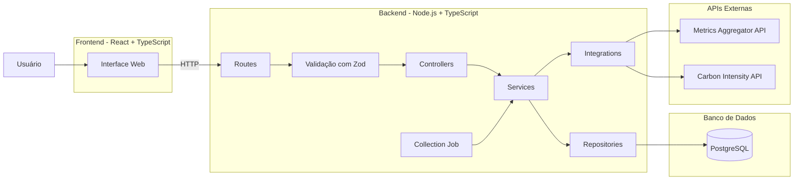

O backend funciona como intermediário entre o frontend, o banco de dados e as
APIs externas.

---

# 4. Organização Geral do Projeto

A estrutura do projeto organiza frontend, backend, banco de dados e
documentação em áreas separadas:

```text
greener/
│
├── README.md
├── .env.example
├── compose.yaml
│
├── frontend/
│   ├── Dockerfile
│   └── src/
│       ├── app/
│       ├── components/
│       ├── pages/
│       ├── services/
│       ├── hooks/
│       ├── contexts/
│       ├── types/
│       └── lib/
│
├── backend/
│   ├── arquitetura.md
│   ├── Dockerfile
│   └── src/
│       ├── app.ts
│       ├── server.ts
│       ├── index.ts
│       │
│       ├── db/
│       │   └── connection.ts
│       │
│       ├── integrations/
│       │   ├── metrics-api.ts
│       │   ├── metrics-api.schema.ts
│       │   ├── carbon-api.ts
│       │   └── carbon-api.schema.ts
│       │
│       ├── jobs/
│       │   └── collections.job.ts
│       │
│       ├── modules/
│       │   │
│       │   ├── auth/
│       │   │   ├── auth.routes.ts
│       │   │   ├── auth.controller.ts
│       │   │   ├── auth.service.ts
│       │   │   └── auth.schema.ts
│       │   │
│       │   ├── collections/
│       │   │   ├── collections.routes.ts
│       │   │   ├── collections.controller.ts
│       │   │   ├── collections.service.ts
│       │   │   ├── collections.repository.ts
│       │   │   ├── collections.types.ts
│       │   │   └── collections.schema.ts
│       │   │
│       │   │
│       │   │
│       │   │
│       │   ├── services/
│       │   │   ├── services.routes.ts
│       │   │   ├── services.controller.ts
│       │   │   ├── services.service.ts
│       │   │   ├── services.repository.ts
│       │   │   ├── services.types.ts
│       │   │   └── services.schema.ts
│       │   │
│       │   ├── regions/
│       │   │   ├── regions.routes.ts
│       │   │   ├── regions.controller.ts
│       │   │   ├── regions.service.ts
│       │   │   └── regions.schema.ts
│       │   │
│       │   ├── analytics/
│       │   │   ├── analytics.routes.ts
│       │   │   ├── analytics.controller.ts
│       │   │   ├── analytics.service.ts
│       │   │   ├── analytics.repository.ts
│       │   │   ├── analytics.types.ts
│       │   │   └── analytics.schema.ts
│       │   │
│       │   ├── monitoring/
│       │   │   ├── monitoring.routes.ts
│       │   │   ├── monitoring.controller.ts
│       │   │   ├── monitoring.service.ts
│       │   │   └── monitoring.types.ts
│       │   │
│       │   └── monitoring-settings/
│       │       ├── monitoring-settings.routes.ts
│       │       ├── monitoring-settings.controller.ts
│       │       ├── monitoring-settings.service.ts
│       │       ├── monitoring-settings.repository.ts
│       │       └── monitoring-settings.schema.ts
│       │
│       └── shared/
│           ├── errors/
│           ├── middlewares/
│           └── types/
│
└── docs/
    ├── API.md
    ├── cálculo.md
    ├── plano-de-entregas.md
    └── sprints/
```

O módulo `monitoring` está implementado e expõe
`GET /api/v1/monitoring/status`. O `monitoring.service.ts` guarda em memória os
horários, contadores e resultados informados pelo job e pelo serviço de coleta;
o controller entrega esses dados em JSON. Não há arquivo `state`, repository
ou tabela própria para esse módulo. Seus dados são reiniciados com o processo.
Ele é separado de `monitoring-settings`, responsável pelas configurações.

A árvore também contém a organização prevista para funcionalidades futuras;
ela não comprova que todos os módulos e arquivos já estejam implementados.

Novas pastas e abstrações devem representar responsabilidades reais do sistema
e preservar os limites entre interface, regras de negócio, integrações e
persistência.

---

# 5. Organização do Backend

O backend é organizado em diferentes responsabilidades:

```text
HTTP
 ↓
Routes
 ↓
Validação
 ↓
Controllers
 ↓
Services
 ↓
Repositories / Integrations
 ↓
PostgreSQL / APIs externas
```

Cada camada possui uma responsabilidade específica.

---

# 7. Validação com Zod

O Zod é utilizado para validar dados em tempo de execução.

O TypeScript realiza validação de tipos durante o desenvolvimento, porém não
garante que dados recebidos através da rede tenham realmente o formato esperado.

Por esse motivo, o Zod é utilizado para validar:

- `body`;
- `params`;
- `query parameters`;
- respostas recebidas das APIs externas.

---

## 7.1 Validação das requisições

Exemplo de fluxo:

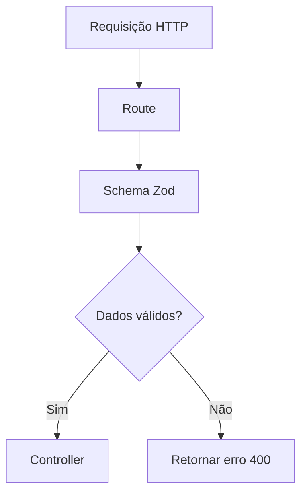

O contrato das requisições está descrito em
[docs/API.md](../docs/API.md).

Antes do controller receber os dados:

```text
Request
   ↓
Zod
   ↓
Dados válidos
   ↓
Controller
```

---

# 8. Validação das APIs Externas

Os dados retornados pelas APIs externas também devem ser considerados dados não
confiáveis até serem validados.

Por exemplo:

```text
Metrics API
    ↓
fetch
    ↓
JSON
    ↓
Zod
    ↓
objeto validado
    ↓
Service
```

Fluxo:

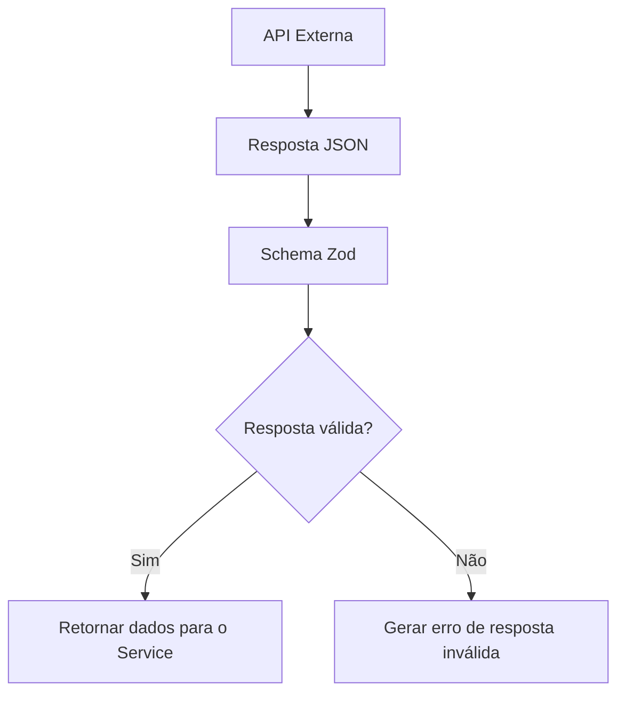

Isso evita que uma mudança inesperada na API externa gere dados incorretos
dentro da aplicação.

---

# 9. Controllers

Os controllers representam a camada HTTP da aplicação.

Responsabilidades:

- receber dados já validados;
- acessar parâmetros da requisição;
- chamar o service correspondente;
- definir status HTTP;
- retornar respostas JSON.

Exemplo:

```text
Route
  ↓
Controller
  ↓
Service
```

O controller não deve:

```text
❌ executar SQL
❌ acessar PostgreSQL diretamente
❌ fazer cálculos ambientais
❌ executar fetch para API externa
❌ implementar regras de negócio
```

---

# 10. Services

Os services concentram as regras de negócio e a coordenação das operações.

Eles podem utilizar:

- repositories;
- integrations;
- outros componentes necessários à regra de negócio.

Exemplo:

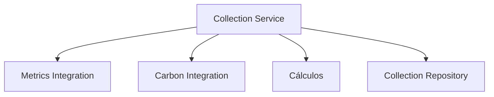

O Collection Service:

1. solicitar as métricas de um serviço;
2. obter a intensidade de carbono;
3. validar entradas e parâmetros do modelo;
4. calcular potência, energia e CO₂e conforme
   [docs/cálculo.md](../docs/cálculo.md);
5. criar uma coleta com seu contexto;
6. solicitar ao repository que persista os dados.

---

# 11. Repositories

Os repositories concentram todo o acesso ao PostgreSQL.

Exemplo:

```text
Service
   ↓
Repository
   ↓
pg
   ↓
PostgreSQL
```

Os repositories são responsáveis por:

- executar `SELECT`;
- executar `INSERT`;
- executar `UPDATE`;
- executar `DELETE`, quando necessário;
- realizar agregações;
- realizar consultas históricas;
- executar consultas parametrizadas.

Exemplo conceitual:

```text
CollectionRepository

save()

findById()

findByServiceId()

findByPeriod()

findLatestByServiceId()
```

Os repositories não devem:

```text
❌ chamar API externa
❌ calcular CO₂e
❌ controlar intervalo de monitoramento
❌ tratar requisição HTTP
❌ decidir regras de negócio
```

---

# 12. Integrations

A pasta `integrations` concentra a comunicação com sistemas externos.

```text
integrations/
├── metrics-api.ts
├── metrics-api.schema.ts
├── carbon-api.ts
└── carbon-api.schema.ts
```

A ideia é impedir que diferentes módulos da aplicação executem `fetch`
diretamente.

---

# 13. Metrics API Integration

O arquivo:

```text
metrics-api.ts
```

é responsável pela comunicação com a Greener Metrics Aggregator API.

Responsabilidades da integração:

```text
Consultar os serviços disponíveis e obter as métricas de um serviço.
```

Conceitualmente:

```text
getServices()

getMetrics(serviceId)
```

Os endpoints e os formatos das respostas estão descritos em
[docs/API.md](../docs/API.md).

---

# 14. Carbon API Integration

O arquivo:

```text
carbon-api.ts
```

é responsável pela comunicação com a Greener Carbon Intensity API.

Fluxo:

```text
region_code
     ↓
Carbon Integration
     ↓
Carbon API
     ↓
Zod
     ↓
dados validados para o service
```

Os campos utilizados nessa integração estão descritos em
[docs/API.md](../docs/API.md).

---

# 15. Timeout das APIs Externas

As chamadas para APIs externas possuem timeout para evitar que uma chamada que
não responde bloqueie indefinidamente o processo de monitoramento.

O timeout definido para chamadas externas é:

```text
Timeout: 8 segundos
```

O timeout de 8 segundos é uma decisão técnica da equipe.

Fluxo:

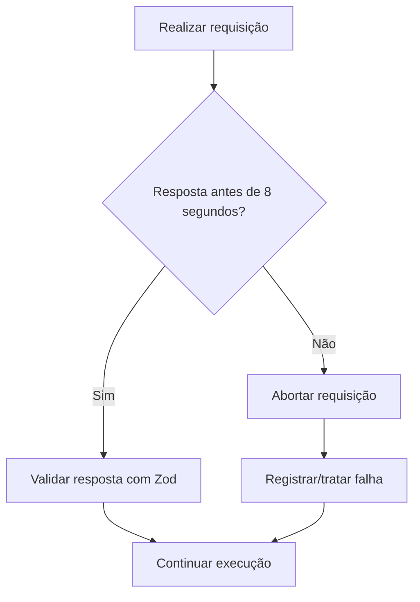

Uma falha em uma chamada externa não deve encerrar toda a aplicação.

---

# 16. Collection Job

O `collection.job.ts` é responsável por iniciar periodicamente o processo de
monitoramento.

O Job não deve implementar as regras de negócio da coleta.

Sua função é determinar **quando** o processo deve iniciar.

As regras sobre **como** executar a coleta ficam no service.

```text
Collection Job
      ↓
Collection Service
```

---

# 17. Configuração do Intervalo

O intervalo utilizado para iniciar as rodadas de monitoramento é uma
configuração persistida no PostgreSQL e administrada pelo módulo
`monitoring-settings`.

Exemplo conceitual:

```text
monitoring_settings

collection_interval_seconds
```

Fluxo:

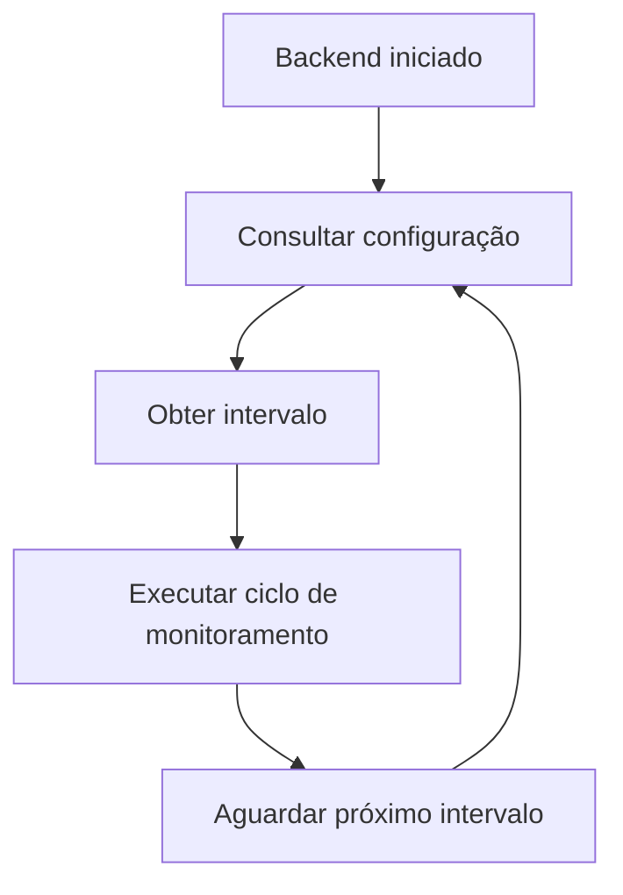

O Job consulta essa configuração para agendar as rodadas de monitoramento.

---

# 18. Diferença entre os Intervalos

Existem dois conceitos que não devem ser confundidos.

## Intervalo do Job

Define com que frequência o GreenER inicia uma nova rodada de monitoramento.

Exemplo:

```text
30 segundos
```

Representação:

```text
Rodada
  ↓
30 segundos
  ↓
Rodada
  ↓
30 segundos
  ↓
Rodada
```

---

## Collection Interval da API

O contrato da Metrics API inclui o intervalo associado às métricas retornadas.
Esse intervalo não deve ser confundido com a frequência do Job. O nome do campo
e seu formato estão descritos em [docs/API.md](../docs/API.md), e seu uso no
cálculo ambiental está em [docs/cálculo.md](../docs/cálculo.md).

---

# 19. Descoberta dos Serviços

Antes de realizar as coletas, o GreenER consulta a API de métricas para obter a
situação atual do ambiente. O endpoint correspondente está descrito em
[docs/API.md](../docs/API.md).

Isso permite detectar:

- novos serviços;
- serviços removidos;
- serviços que retornaram;
- alterações no ambiente monitorado.

Fluxo:

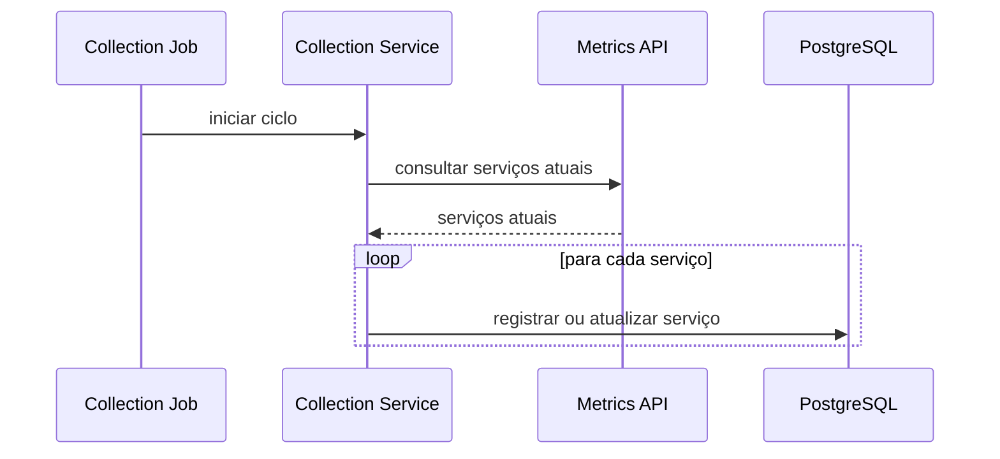

A API externa representa o estado atual dos serviços monitorados.

O banco mantém os dados necessários para histórico e utilização pela aplicação.

---

# 20. Fluxo Geral de Monitoramento

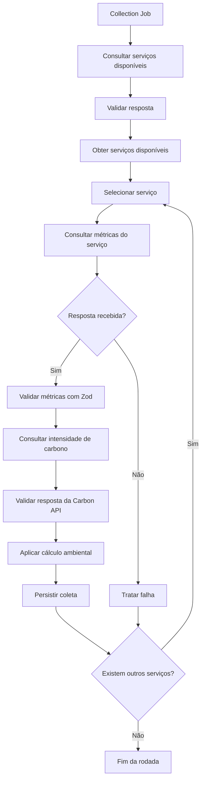

A falha na coleta de um serviço não deve impedir a coleta dos demais.

---

# 21. Collection Service

O Collection Service coordena o caso de uso de uma coleta.

Fluxo simplificado:

```text
collect(service)
    ↓
buscar métricas
    ↓
validar métricas
    ↓
obter intensidade de carbono
    ↓
validar intensidade
    ↓
aplicar o cálculo ambiental descrito em docs/cálculo.md
    ↓
montar coleta
    ↓
persistir
```

Ele atua como o coordenador da operação.

---

# 22. Cálculos Ambientais

O Collection Service coordena os cálculos ambientais após validar as métricas e
obter a intensidade de carbono. As fórmulas e o fluxo detalhado estão em
[docs/cálculo.md](../docs/cálculo.md).

---

# 23. Persistência da Coleta

Depois dos cálculos, o Collection Service envia os dados para o repository.

```text
CollectionService
       ↓
CollectionRepository
       ↓
INSERT
       ↓
PostgreSQL
```

A coleta permanece associada ao serviço correspondente.

Isso permite posteriormente realizar:

- análise histórica;
- gráficos;
- rankings;
- comparações;
- indicadores agregados.

---

# 24. Consulta do Frontend

O frontend não acessa diretamente as APIs externas.

Quando o dashboard precisa dos dados:

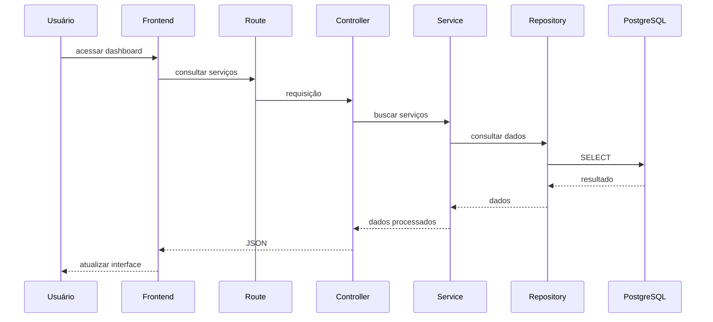

---

# 25. Separação entre Monitoramento e Consulta

O sistema possui dois fluxos principais.

## Fluxo de coleta

```text
Job
 ↓
Service
 ↓
APIs externas
 ↓
cálculos
 ↓
Repository
 ↓
PostgreSQL
```

## Fluxo de consulta

```text
Frontend
 ↓
Route
 ↓
Zod
 ↓
Controller
 ↓
Service
 ↓
Repository
 ↓
PostgreSQL
```

Isso significa que o frontend não precisa esperar uma API externa responder
para visualizar os dados já armazenados.

---

# 26. Atualização do Dashboard

O backend disponibiliza os dados persistidos para consulta pelo dashboard. A
interface consulta periodicamente a API do GreenER, atualiza as informações sem
recarga manual e apresenta o horário da última atualização. A frequência de
consulta do frontend é independente do intervalo do Job.

---

# 27. Tratamento de Falhas

O GreenER deve continuar funcionando mesmo quando alguma operação individual
falhar.

Possíveis falhas:

```text
API externa indisponível

timeout

serviço removido

serviço indisponível

serviço sem métricas

resposta inválida

falha de validação Zod

falha no banco de dados
```

---

# 28. Fluxo de Tratamento de Falhas

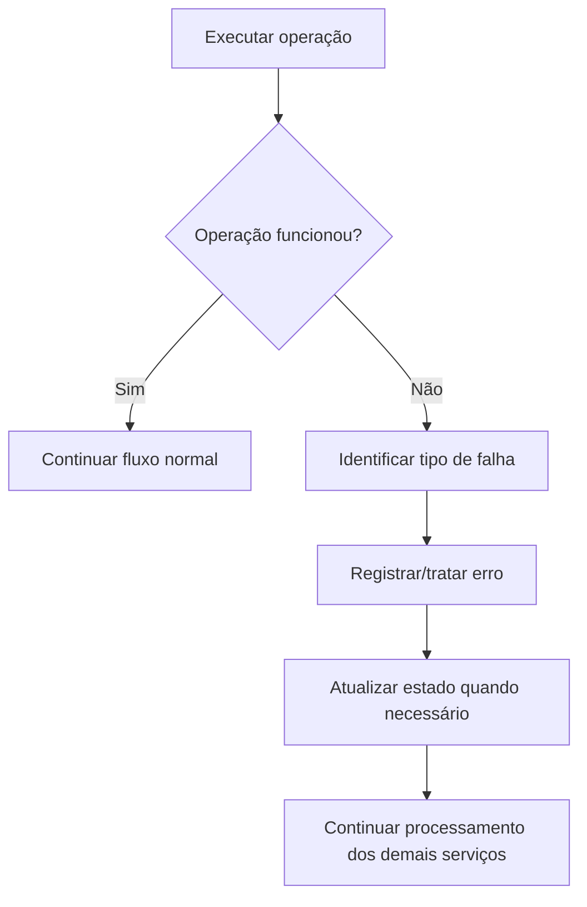

Uma falha em determinado serviço não deve encerrar o monitoramento completo.

---

# 29. Concorrência das Coletas

A arquitetura deve permitir que diferentes serviços sejam coletados sem que um
serviço lento bloqueie necessariamente todos os demais.

Exemplo de uma execução estritamente sequencial:

```text
Serviço A
    ↓
esperar

Serviço B
    ↓
esperar

Serviço C
```

Com timeout de 8 segundos, serviços indisponíveis podem aumentar a duração da
rodada quando são processados em sequência.

Exemplo conceitual:

```text
                  ┌── Serviço A
Collection Job ───┼── Serviço B
                  ├── Serviço C
                  └── Serviço D
```

As coletas usam concorrência limitada para que uma requisição lenta não
bloqueie os demais serviços nem provoque um número ilimitado de operações
simultâneas. Filas ou sistemas distribuídos não fazem parte da arquitetura do
GreenER.

---

# 30. Monitoramento Settings

O módulo `monitoring-settings` é responsável pelas configurações do
monitoramento.

Possíveis configurações:

```text
collection_interval_seconds
```

Fluxo de alteração:

```text
Route
    ↓
Zod
    ↓
Controller
    ↓
Service
    ↓
Repository
    ↓
PostgreSQL
```

Os endpoints de configuração e de simulação estão descritos em
[docs/API.md](../docs/API.md) e exigem autenticação JWT.

---

# 31. Autenticação

A autenticação das operações protegidas, incluindo configurações de
monitoramento e simulações, é realizada no backend utilizando JWT.

Fluxo simplificado:

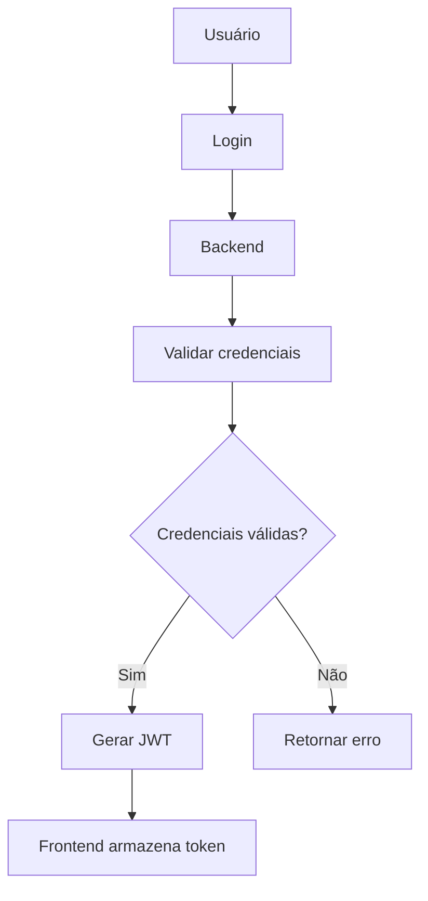

---

# 32. Acesso às Rotas Protegidas

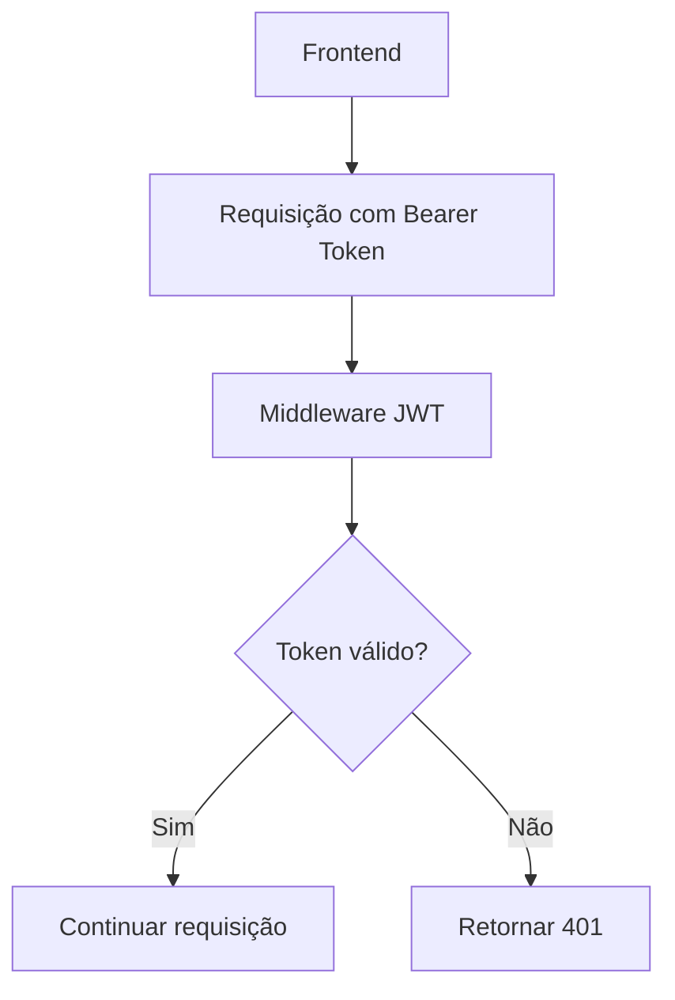

O controle de acesso não deve depender apenas do frontend.

---

# 33. Banco de Dados

O GreenER utiliza PostgreSQL.

A aplicação não utiliza ORM.

O acesso é realizado através do driver:

```text
pg
```

Os comandos SQL são mantidos explicitamente nos repositories.

Exemplo:

```text
Service
 ↓
Repository
 ↓
SQL parametrizado
 ↓
pg
 ↓
PostgreSQL
```

---

# 34. Consultas Parametrizadas

Dados recebidos da aplicação não devem ser concatenados diretamente nas
consultas SQL.

Conceitualmente:

```sql
SELECT *
FROM collections
WHERE service_id = $1;
```

Os valores são enviados separadamente através do driver PostgreSQL.

Isso reduz o risco de SQL Injection e mantém a separação entre comando e dados.

---

# 35. Docker

Toda a aplicação deve ser executável através de containers Docker.

A composição principal possui:

```text
Docker Compose
│
├── frontend
│
├── backend
│
└── PostgreSQL
```

Fluxo:

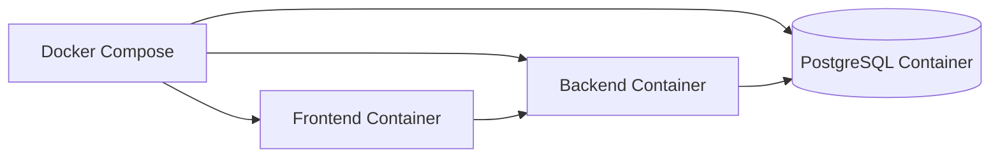

O banco deve utilizar volume persistente para manter os registros mesmo após a
reinicialização dos containers.

---

# 36. Fluxo Completo do GreenER

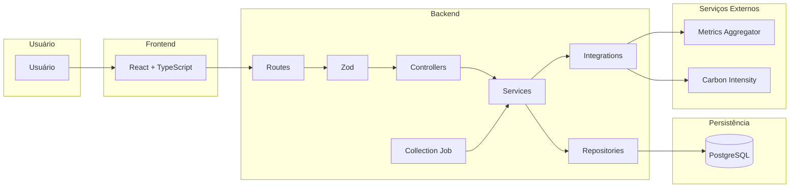

---

# 37. Resumo das Responsabilidades

| Componente     | Responsabilidade                                          |
| -------------- | --------------------------------------------------------- |
| Frontend       | Apresentar informações e permitir interação com o usuário |
| Routes         | Definir endpoints HTTP                                    |
| Zod            | Validar entradas e dados externos em runtime              |
| Controllers    | Receber requisições e produzir respostas HTTP             |
| Services       | Implementar e coordenar regras de negócio                 |
| Repositories   | Concentrar acesso ao PostgreSQL                           |
| Integrations   | Concentrar comunicação com APIs externas                  |
| Collection Job | Iniciar periodicamente os ciclos de monitoramento         |
| Auth           | Autenticar usuários e emitir tokens JWT                   |
| Regions        | Disponibilizar dados regionais de intensidade de carbono  |
| Analytics      | Fornecer rankings, comparações e cenários                 |
| PostgreSQL     | Persistir serviços, coletas e configurações               |
| Metrics API    | Fornecer serviços e métricas                              |
| Carbon API     | Fornecer intensidade de carbono                           |
| JWT Middleware | Proteger endpoints que exigem autenticação                |

---

# 38. Decisões Arquiteturais

## 38.1 Backend modular

O backend é organizado em módulos de acordo com os recursos e
responsabilidades da aplicação.

Exemplos:

```text
collections

services

monitoring-settings
```

---

## 38.2 Separação entre Controller e Service

Controllers tratam HTTP.

Services tratam regras de negócio.

Essa separação evita que regras importantes fiquem diretamente ligadas ao
Express.

---

## 38.3 Repository para acesso ao banco

O acesso ao PostgreSQL fica concentrado nos repositories.

Isso permite manter as consultas SQL separadas das regras de negócio.

---

## 38.4 Integration para APIs externas

Chamadas HTTP para sistemas externos ficam concentradas na camada de
`integrations`.

Isso evita duplicação de código e facilita o tratamento de:

- timeout;
- respostas inválidas;
- indisponibilidade;
- mudanças no formato das APIs.

---

## 38.5 Zod para validação runtime

O Zod é utilizado para garantir que dados recebidos externamente possuam o
formato esperado antes de serem utilizados pela aplicação.

O Zod é utilizado tanto nas requisições recebidas pelo GreenER quanto nas
respostas recebidas das APIs auxiliares.

---

## 38.6 Job separado da regra de negócio

O Job é responsável somente pelo agendamento da execução.

A coleta propriamente dita pertence ao Collection Service.

```text
Job
 ↓
Service
```

Isso permite reutilizar o mesmo service independentemente de quem iniciou a
operação.

---

## 38.7 Timeout de 8 segundos

As chamadas para APIs externas utilizam timeout de:

```text
8 segundos
```

Uma chamada que excede esse limite é abortada e tratada como falha daquela
operação; a rodada continua processando os demais serviços.

---

## 38.8 Persistência histórica

As coletas são armazenadas no PostgreSQL e sustentam consultas históricas,
gráficos, classificações, comparações e indicadores consolidados.

Os dados persistidos são consultados pela API do GreenER e apresentados pelo
frontend conforme os critérios e períodos selecionados.

---

# 39. Classificação das Decisões

É importante diferenciar requisitos obrigatórios de decisões internas da equipe.

## Requisitos do produto

- React com TypeScript;
- Node.js com TypeScript;
- PostgreSQL;
- SQL explícito;
- sem ORM;
- Docker;
- JWT no backend;
- coleta periódica;
- histórico das coletas;
- tolerância a falhas;
- organização do backend em módulos, controllers e services;
- API HTTP para comunicação com o frontend.

## Decisões arquiteturais adotadas

- utilização de Express;
- utilização de Zod;
- utilização de `pg`;
- pasta `integrations`;
- pasta `jobs`;
- timeout de 8 segundos;
- armazenamento do intervalo de monitoramento no banco;
- organização interna dos arquivos dos módulos.

## Parâmetros de operação

O intervalo de monitoramento é configurável por meio do módulo
`monitoring-settings` e persistido no PostgreSQL. O intervalo de atualização da
interface é um parâmetro distinto, mantido independente do agendamento do Job.
Políticas operacionais adicionais, como número máximo de coletas concorrentes e
novas tentativas, devem respeitar os limites de tolerância a falhas sem
introduzir filas ou serviços distribuídos na arquitetura inicial.

---

# 40. Arquitetura Resumida

```text
                              USUÁRIO
                                 │
                                 ▼
                    ┌──────────────────────┐
                    │       FRONTEND       │
                    │   React + TypeScript │
                    └──────────┬───────────┘
                               │ HTTP
                               ▼
                    ┌──────────────────────┐
                    │        ROUTES        │
                    └──────────┬───────────┘
                               │
                               ▼
                    ┌──────────────────────┐
                    │         ZOD          │
                    │      Validação       │
                    └──────────┬───────────┘
                               │
                               ▼
                    ┌──────────────────────┐
                    │     CONTROLLERS      │
                    └──────────┬───────────┘
                               │
                               ▼
                    ┌──────────────────────┐
                    │       SERVICES       │
                    │ Regras de negócio    │
                    └─────┬─────────┬──────┘
                          │         │
              ┌───────────┘         └────────────┐
              ▼                                  ▼
    ┌─────────────────────┐           ┌─────────────────────┐
    │    REPOSITORIES     │           │    INTEGRATIONS     │
    │    SQL explícito    │           │ APIs externas       │
    └─────────┬───────────┘           └──────────┬──────────┘
              │                                  │
              ▼                         ┌────────┴─────────┐
        ┌─────────────┐                 ▼                  ▼
        │ PostgreSQL  │           Metrics API        Carbon API
        └─────────────┘


                     COLLECTION JOB
                           │
                           │ inicia periodicamente
                           ▼
                       SERVICES
```

---

# 41. Fluxo Resumido de uma Coleta

```text
Collection Job
      ↓
consultar configurações
      ↓
Collection Service
      ↓
consultar serviços disponíveis
      ↓
para cada serviço
      ↓
consultar e validar métricas
      ↓
obter e validar intensidade de carbono
      ↓
aplicar cálculo ambiental descrito em docs/cálculo.md
      ↓
Collection Repository
      ↓
PostgreSQL
```

---

# 42. Objetivo da Arquitetura

A arquitetura do GreenER mantém uma separação clara de responsabilidades,
permitindo que cada parte da aplicação tenha um objetivo específico.

O objetivo não é criar o maior número possível de camadas ou abstrações, mas
organizar o sistema de maneira que seja possível compreender:

- quem recebe a requisição;
- quem valida os dados;
- quem executa regras de negócio;
- quem acessa APIs externas;
- quem acessa o banco;
- quem executa as coletas periódicas;
- onde os cálculos ambientais são realizados;
- como os dados chegam até o usuário.

Dessa forma, o GreenER é construído por etapas sobre uma estrutura
compreensível, preservando os contratos entre frontend, backend, integrações e
persistência.
