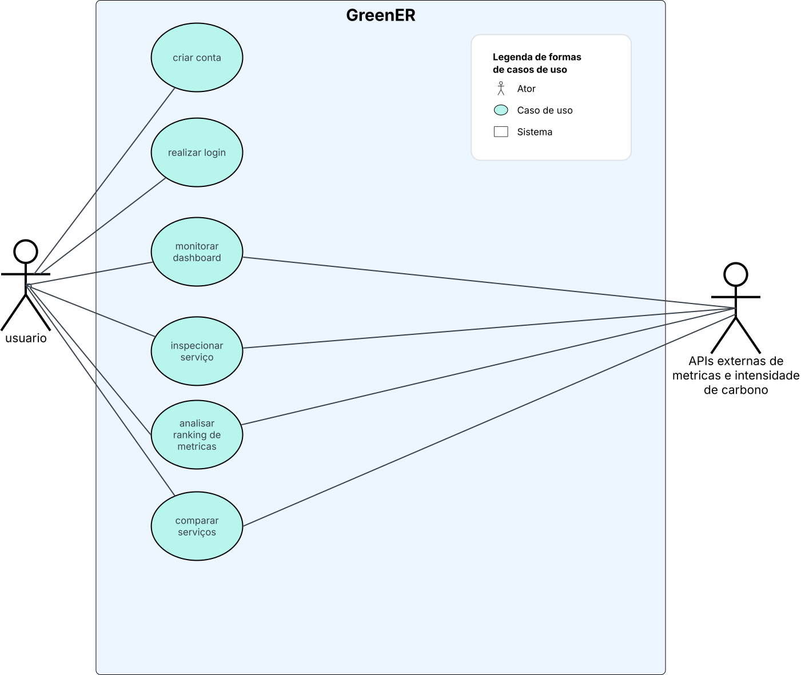
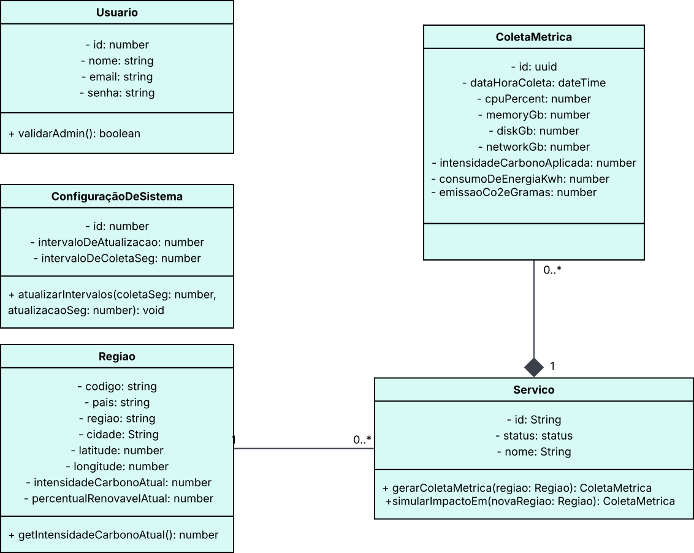
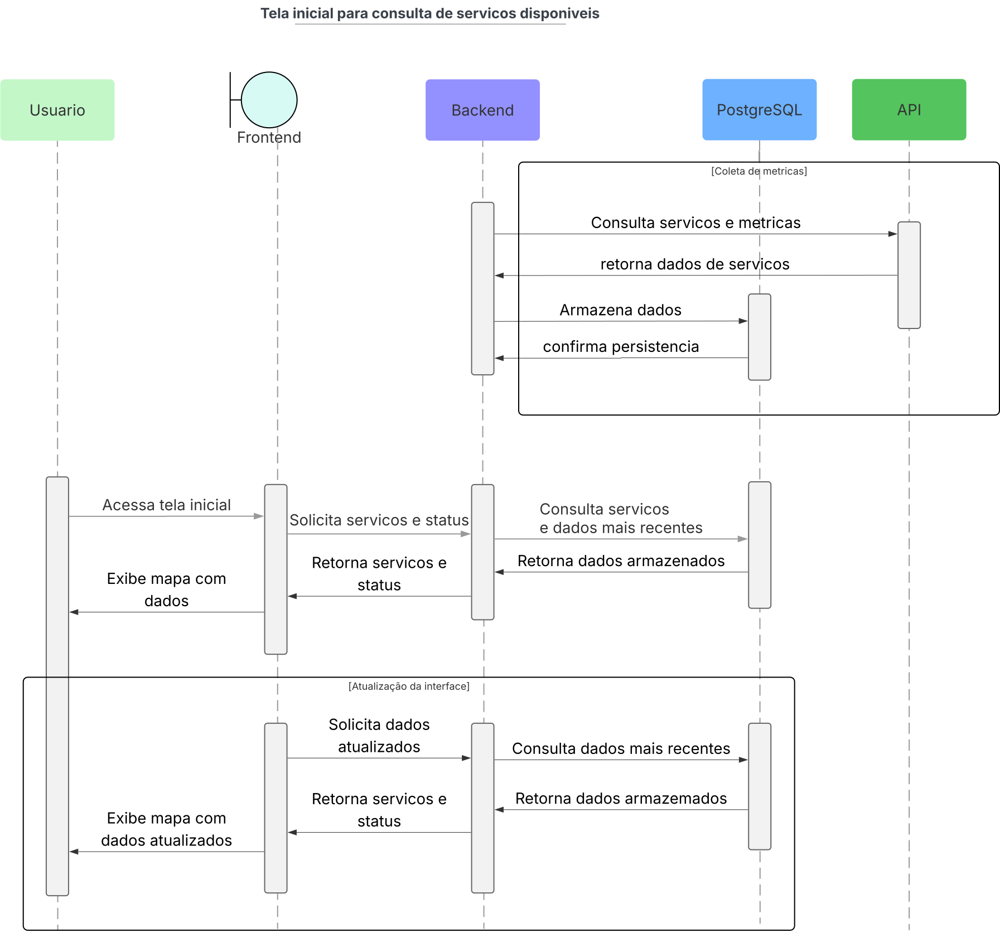
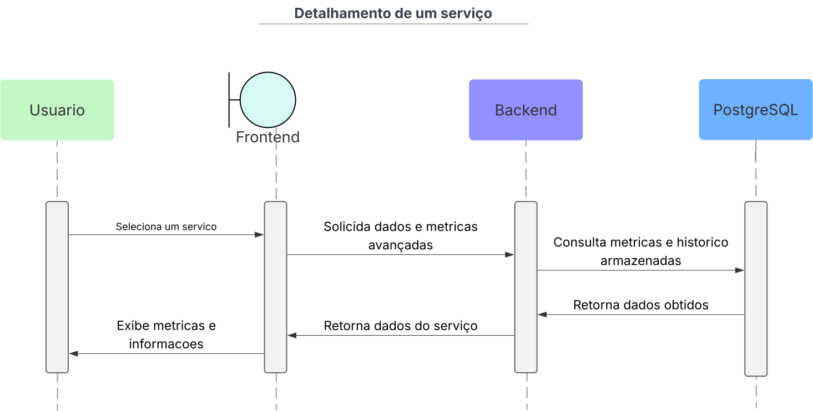
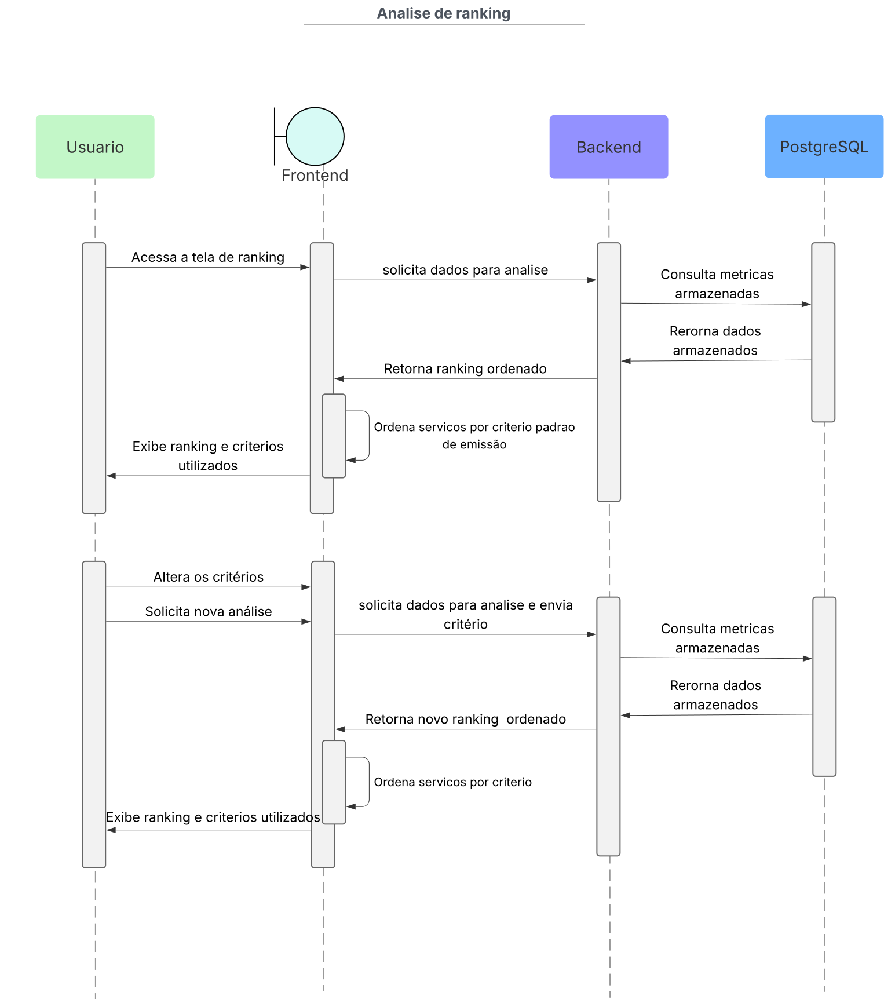
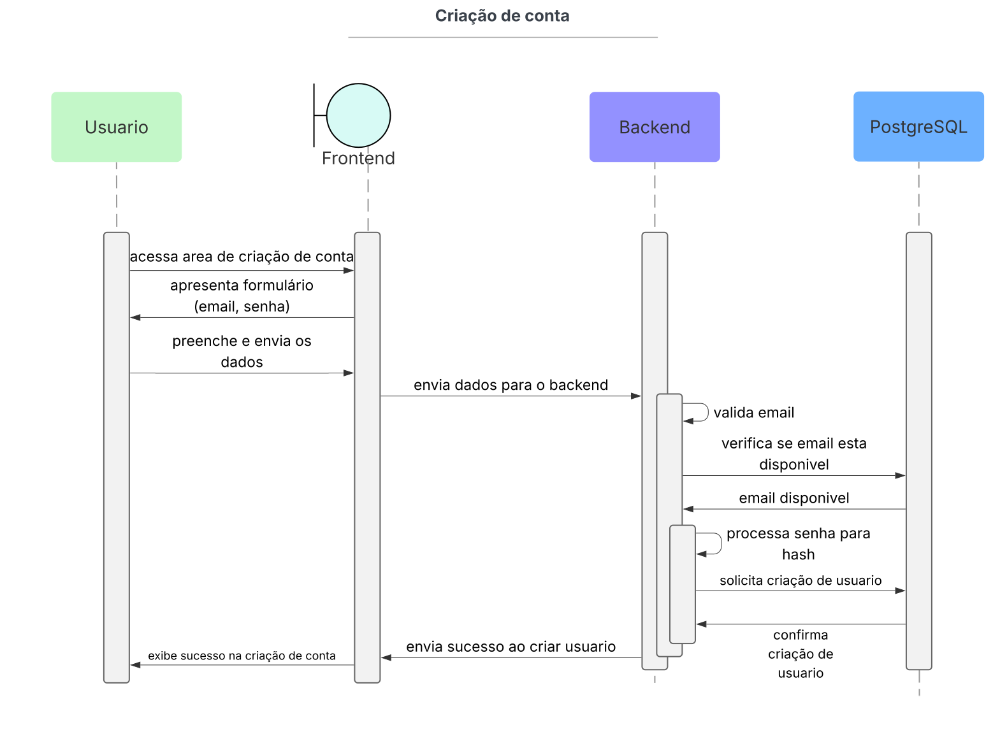
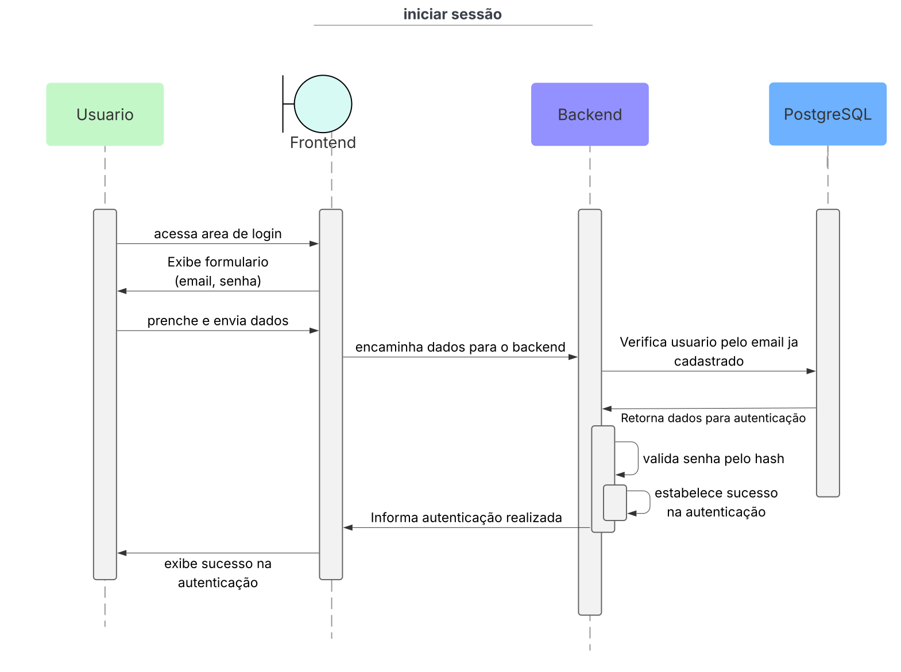
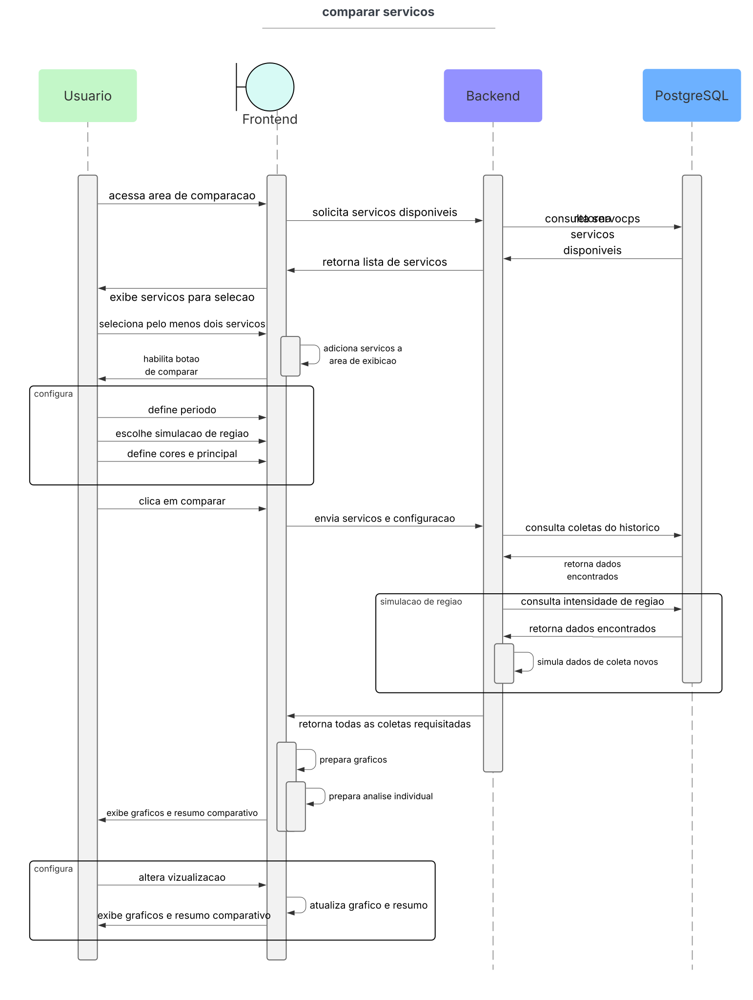

# 🏗️ Arquitetura e Modelagem

Os diagramas representam a modelagem do produto e incluem fluxos futuros.
Não comprovam que mapa, atualização automática, autenticação ou ranking já
estejam implementados. O estado executável está no [README](../../README.md)
e o compromisso por sprint no [plano](../plano-de-entregas.md).

Esta seção reúne os artefatos de modelagem desenvolvidos para o projeto **GreenER**.

Os diagramas servem como apoio para análise, implementação e evolução da solução ao longo das sprints, permitindo visualizar os principais elementos e comportamentos da plataforma.

Além da visualização em imagem, os diagramas possuem seus respectivos arquivos editáveis no Lucidchart, possibilitando consulta detalhada e navegação pelos elementos modelados.

---

## 🛠️ Ferramenta Utilizada

Ferramenta utilizada para a criação e manutenção dos diagramas UML do projeto.

Por meio dela são desenvolvidos os diagramas utilizados na documentação da aplicação, permitindo representar visualmente os principais aspectos da solução.

---

## 📋 Diagramas Disponíveis

| Diagrama      | Descrição                                                                                   |
| ------------- | ------------------------------------------------------------------------------------------- |
| Caso de Uso   | Representa os atores envolvidos e os principais objetivos disponíveis na plataforma         |
| Classes       | Representa a estrutura do sistema, suas entidades, atributos, métodos e relacionamentos     |
| Sequência     | Representa a interação entre os participantes do sistema ao longo do tempo                  |

---

# 🎯 Diagrama de Caso de Uso

## Visualização

    

## Arquivo Original

🔗 Lucidchart: [Acessar diagrama](https://lucid.app/lucidchart/547778f4-32b2-4cc9-9630-ae5ce0b6e4be/view)

## Objetivo

Representar os atores envolvidos no sistema e os principais objetivos que podem ser realizados dentro da plataforma GreenER.

---

# 🧩 Diagrama de Classes

## Visualização

    

## Arquivo Original

🔗 Lucidchart: [Acessar diagrama](https://lucid.app/lucidchart/37acad31-54dc-4cac-aff9-a3d7c1721d7a/view)

## Objetivo

Representar a estrutura estática do sistema, evidenciando as principais entidades do domínio, seus atributos, métodos e relacionamentos, servindo como base para implementação e evolução da aplicação.

---

# 🔄 Diagramas de Sequência

Os diagramas de sequência disponíveis estão em `./images/diagramas-de-sequencia/`.
Consulta com mapa e atualização representa o fluxo-alvo da Sprint 1; ranking
é planejado para a Sprint 2. Lista, detalhe e histórico já consomem o backend real.
O globo está integrado; apresentar os serviços associados ao inspecionar uma região
foi transferido para a Sprint 2 como continuação de T15. Diagramas permanecem
modelos de referência e não substituem as evidências da implementação.

## Consulta de serviços

### Visualização

    

### Arquivo Original

🔗 [Acessar diagrama](https://lucid.app/lucidchart/c8a01b5a-88b4-4b01-a1e9-4492dd0211bf/view)

### Objetivo

Exibir os serviços disponíveis e seus status no mapa da tela inicial, com atualização periódica das informações.

## Dashboard de serviço

### Visualização

    

### Arquivo Original

🔗 [Acessar diagrama](https://lucid.app/lucidchart/37409460-c872-42ef-85f5-821b911c639b/view)

### Objetivo

Permitir que o usuário selecione um serviço e visualize suas métricas e informações detalhadas.

## Análise de ranking

### Visualização

    

### Arquivo Original

🔗 [Acessar diagrama](https://lucid.app/lucidchart/0d8a9485-9648-4c4b-a320-cb80d819d560/edit?viewport_loc=-1452%2C-652%2C4836%2C2381%2CPaLdq~84CkD7&invitationId=inv_cefaa363-b9c6-4e1f-a7e3-b3593e8feeb7)

### Objetivo

Permitir que o usuário visualize os serviços ordenados por critérios de priorização e configure critérios para gerar novas classificações.

## criar conta

### Visualização

    

### Arquivo Original

🔗 [Acessar diagrama](https://lucid.app/lucidchart/2e171156-d112-442a-afd4-ee7358c03b40/view)

### Objetivo

Permitir que o usuário crie uma conta no GreenER, fornecendo os dados necessários para seu cadastro no sistema.

## iniciar sessão

### Visualização

    

### Arquivo Original

🔗 [Acessar diagrama](https://lucid.app/lucidchart/b1632091-cae7-4b89-9deb-60ae0eb3a544/view)

### Objetivo

Permitir que o usuário autentique-se no GreenER por meio de suas credenciais para acessar as funcionalidades disponíveis.

## Comparação de serviços

### Visualização

    

### Arquivo Original

🔗 [Acessar diagrama](https://lucid.app/lucidchart/bcb4318a-2d7c-44e7-b5cc-99eee1e67e4f/view)

### Objetivo

Permitir a comparação entre serviços no GreenER, desde a seleção dos serviços e configuração dos parâmetros até a consulta das métricas pelo backend e a exibição dos resultados no frontend.