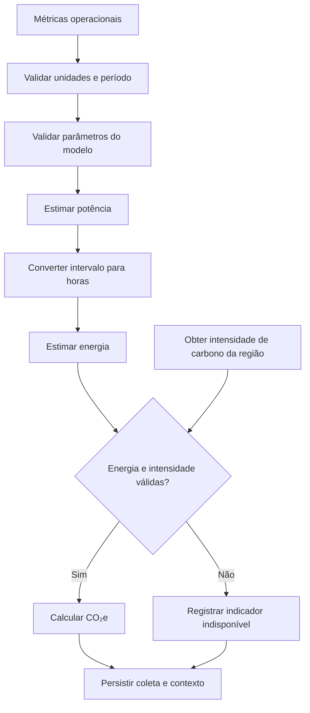

# Cálculos Ambientais — GreenER

Este documento define o fluxo e o modelo de cálculo ambiental do GreenER. A
orquestração da coleta é responsabilidade do Collection Service, conforme a
[`../backend/arquitetura.md`](../backend/arquitetura.md). As métricas
operacionais são obtidas da Greener Metrics Aggregator API e a intensidade de
carbono, da Greener Carbon Intensity API, por meio das integrações do backend.

## 1. Princípios do cálculo

- Todos os valores calculados são estimativas, não medições físicas diretas da
  infraestrutura.
- Um resultado só é calculado e apresentado quando suas entradas, unidades,
  período e parâmetros do modelo são válidos e rastreáveis.
- CPU, memória, disco e rede não são, isoladamente, medidas de energia. Sua
  conversão em potência exige os parâmetros de estimativa definidos neste
  modelo e valores tecnicamente fundamentados.
- Se energia não puder ser estimada com parâmetros válidos, o sistema não
  calcula CO₂e a partir das métricas operacionais. O indicador ambiental fica
  indisponível, em vez de ser apresentado como zero ou como resultado
  fundamentado.
- A intensidade de carbono deve corresponder à região do serviço e ao contexto
  temporal da coleta.

## 2. Entradas e parâmetros

O modelo recebe:

| Entrada | Unidade | Origem |
|---|---|---|
| Utilização de CPU | % | Metrics Aggregator API |
| Memória utilizada | GB | Metrics Aggregator API |
| Uso de disco | GB | Metrics Aggregator API |
| Tráfego de rede | GB | Metrics Aggregator API |
| Intervalo associado às métricas | segundos | Metrics Aggregator API |
| Potência máxima de CPU | W | Parâmetro documentado do modelo |
| Fator de consumo da memória | W/GB | Parâmetro documentado do modelo |
| Fator de consumo do disco | W/GB | Parâmetro documentado do modelo |
| Fator de consumo da rede | W/GB | Parâmetro documentado do modelo |
| Intensidade de carbono | gCO₂e/kWh | Carbon Intensity API |

Os parâmetros do modelo não são valores universais. Cada valor usado pelo
backend deve ter fonte, unidade, justificativa e versão documentadas. Nenhum
parâmetro ausente pode ser substituído por uma constante arbitrária.

## 3. Estimativa de potência

A potência estimada do serviço é a soma das parcelas de CPU, memória, disco e
rede:

```text
Potência Estimada (W) =
    Potência CPU
    + Potência Memória
    + Potência Disco
    + Potência Rede
```

### 3.1. CPU

```text
Potência CPU (W) =
    (Uso de CPU (%) / 100)
    × Potência Máxima da CPU (W)
```

### 3.2. Memória

```text
Potência Memória (W) =
    Memória Utilizada (GB)
    × Fator de Consumo da Memória (W/GB)
```

### 3.3. Disco

```text
Potência Disco (W) =
    Uso de Disco (GB)
    × Fator de Consumo do Disco (W/GB)
```

### 3.4. Rede

```text
Potência Rede (W) =
    Tráfego de Rede (GB)
    × Fator de Consumo da Rede (W/GB)
```

As parcelas de memória, disco e rede são estimativas do modelo, não leituras
diretas de potência. Os fatores precisam ser definidos e fundamentados antes
que o backend use essas equações para produzir resultados ambientais. Se a
unidade ou interpretação da métrica recebida não corresponder à unidade exigida
pelo fator, a entrada deve ser normalizada de acordo com uma regra documentada
ou não deve ser usada no cálculo.

## 4. Estimativa de energia

O `collection_interval_seconds` retornado junto às métricas representa o
intervalo da amostra. Ele é distinto do intervalo do Collection Job, que
determina a frequência das rodadas de coleta.

Conversão do período para horas:

```text
Tempo de Coleta (h) =
    collection_interval_seconds / 3600
```

Conversão da potência estimada em energia:

```text
Energia (kWh) =
    Potência Estimada (W)
    × Tempo de Coleta (h)
    / 1000
```

Exemplo de conversão temporal:

```text
27 segundos / 3600 = 0,0075 horas
```

O resultado representa a energia estimada no intervalo da amostra, não
necessariamente o consumo acumulado do serviço durante outro período.

## 5. Estimativa de emissão de CO₂e

Quando há energia calculada e intensidade de carbono válida para a região e o
período correspondentes:

```text
CO₂e (g) =
    Energia (kWh)
    × Intensidade de Carbono (gCO₂e/kWh)
```

A intensidade de carbono e a participação renovável são fornecidas pela Carbon
Intensity API. Valores exemplificativos não devem ser usados como valores
constantes nem como substitutos de uma resposta regional e temporal válida.

## 6. Orquestração e armazenamento

Para cada serviço, o Collection Service:

1. valida as métricas e o intervalo da amostra;
2. obtém e valida a intensidade de carbono da região;
3. verifica a disponibilidade e a validade dos parâmetros do modelo;
4. estima potência e energia;
5. calcula CO₂e quando as entradas necessárias forem válidas;
6. persiste a coleta e os resultados com serviço, período, região e contexto
   necessários à consulta histórica.

Uma falha ou entrada inválida em um serviço é registrada e tratada sem impedir
o processamento dos demais. Uma coleta sem dados suficientes pode ser
persistida como indisponível, mas não recebe valor ambiental fabricado.

## 7. Fluxo do cálculo



## 8. Apresentação e interpretação

O backend fornece os resultados calculados, seus valores de origem, unidades,
período e região. O frontend identifica os indicadores como estimativas e
preserva seu contexto ao exibir históricos, rankings e comparações. Uma
simulação de região alternativa é identificada como cenário hipotético e
apresenta explicitamente os parâmetros usados.
