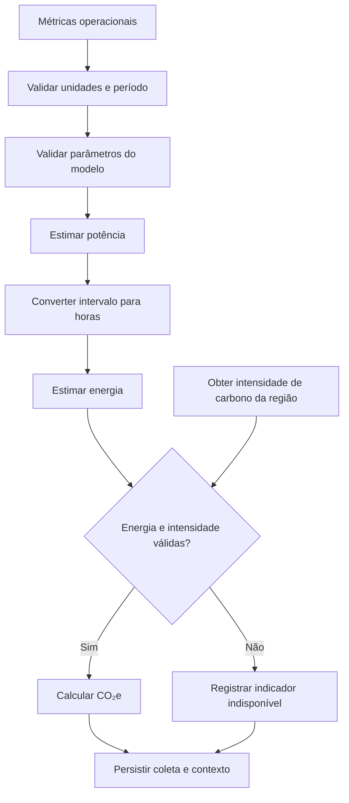

# Cálculos Ambientais — GreenER

Este documento define o fluxo e o modelo de cálculo ambiental do GreenER. A
orquestração da coleta é responsabilidade do Collection Service, conforme a
[`../backend/arquitetura.md`](../backend/arquitetura.md). As métricas
operacionais são obtidas da Greener Metrics Aggregator API e a intensidade de
carbono, da Greener Carbon Intensity API, por meio das integrações do backend.

## Estado da implementação e limitações

As fórmulas implementadas seguem o modelo simplificado do
[Greener — ABP 2º Semestre](https://docs.unilaunch.org/share/x29w8jgwdb/p/greener-abp-2-semestre-b7FiqU6UC1),
nas seções “Modelo de Cálculo Simplificado” e “Exemplo”. Os quatro fatores
iniciais do SQL coincidem com os valores desse exemplo.

O desafio utiliza uma referência didática comum para comparar serviços e
regiões; não exige que os resultados representem o consumo elétrico medido de
um servidor específico. Os coeficientes não são uma calibração do hardware real.

O código valida entradas numéricas com Zod e restrições SQL, consulta o conjunto
ativo e usa a intensidade regional armazenada. Não verifica adequação ao
hardware nem a idade máxima aceitável do fator de carbono.
Se a Carbon API falhar, pode reutilizar regiões previamente sincronizadas.
O horário local de atualização da região não é timestamp de medição do fornecedor.

## 1. Princípios do cálculo

- Todos os valores calculados são estimativas, não medições físicas diretas da
  infraestrutura.
- Os resultados devem identificar entradas, unidades, período e parâmetros
  utilizados, tendo o modelo do desafio como referência.
- CPU, memória, disco e rede não são, isoladamente, medidas de energia. Sua
  conversão em potência utiliza os coeficientes do modelo simplificado do desafio.
- Se energia não puder ser estimada com parâmetros válidos, o sistema não
  calcula CO₂e a partir das métricas operacionais. O indicador ambiental fica
  indisponível, em vez de ser apresentado como zero ou como resultado
  fundamentado.
- A intensidade de carbono deve corresponder à região do serviço e ao contexto
  temporal da coleta.

## 2. Entradas e parâmetros

O modelo recebe:

| Entrada | Unidade | Origem |
|---|---|---|
| Utilização de CPU | % | Metrics Aggregator API |
| Memória utilizada | GB | Metrics Aggregator API |
| Uso de disco | GB | Metrics Aggregator API |
| Tráfego de rede | GB | Metrics Aggregator API |
| Intervalo associado às métricas | segundos | Metrics Aggregator API |
| Potência máxima de CPU | W | Conjunto ativo de parametro_estimativa |
| Fator de consumo da memória | W/GB | Conjunto ativo de parametro_estimativa |
| Fator de consumo do disco | W/GB | Conjunto ativo de parametro_estimativa |
| Fator de consumo da rede | W/GB | Conjunto ativo de parametro_estimativa |
| Intensidade de carbono | gCO₂e/kWh | Carbon Intensity API |

Os parâmetros não são valores universais. A referência dos valores iniciais é
o exemplo do desafio; a tabela abaixo registra sua aplicação. Uma mudança do
conjunto ativo deve registrar valores e motivo, preservando a comparação com
o modelo de referência.

### Valores iniciais utilizados

O [schema](../database/schema.sql) insere um conjunto ativo; o
[repository](../backend/src/modules/collections/collections.repository.ts)
consulta o conjunto vigente, que pode ter sido alterado em um banco existente.
O [serviço](../backend/src/modules/collections/collections.service.ts) aplica as fórmulas.

| Campo | Valor inicial | Unidade no modelo | Fonte e justificativa |
|---|---|---|---|
| cpu_max_watts | 100 | W | Exemplo do desafio, `CPU_MAX_WATTS`: referência de potência multiplicada pela fração de uso da CPU. |
| ram_watts_per_gb | 0.375 | W/GB | Exemplo do desafio, `RAM_WATTS_PER_GB`: coeficiente aplicado à memória utilizada. |
| disk_watts_per_gb | 0.01 | W/GB | Exemplo do desafio, `DISK_WATTS_PER_GB`: coeficiente aplicado ao uso de disco. |
| network_watts_per_gb | 0.02 | W/GB | Exemplo do desafio, `NETWORK_WATTS_PER_GB`: coeficiente aplicado ao tráfego de rede, conforme a simplificação fornecida. |

Fonte dos quatro valores e das unidades: [documento do desafio, seção “Exemplo”](https://docs.unilaunch.org/share/x29w8jgwdb/p/greener-abp-2-semestre-b7FiqU6UC1),
nas unidades apresentadas pelo modelo. O valor de CPU não identifica um processador físico
específico. O fator de rede é aplicado diretamente conforme o modelo fornecido,
sem acrescentar conversão para taxa ou energia por GB que não exista no código.
A intensidade de carbono é obtida regionalmente pela integração, não fixada
nessa carga inicial. Dados de uma instalação existente podem diferir do seed;
cada coleta guarda o identificador do conjunto utilizado.

## 3. Estimativa de potência

A potência estimada do serviço é a soma das parcelas de CPU, memória, disco e
rede:

```text
Potência Estimada (W) =
    Potência CPU
    + Potência Memória
    + Potência Disco
    + Potência Rede
```

### 3.1. CPU

```text
Potência CPU (W) =
    (Uso de CPU (%) / 100)
    × Potência Máxima da CPU (W)
```

### 3.2. Memória

```text
Potência Memória (W) =
    Memória Utilizada (GB)
    × Fator de Consumo da Memória (W/GB)
```

### 3.3. Disco

```text
Potência Disco (W) =
    Uso de Disco (GB)
    × Fator de Consumo do Disco (W/GB)
```

### 3.4. Rede

```text
Potência Rede (W) =
    Tráfego de Rede (GB)
    × Fator de Consumo da Rede (W/GB)
```

As parcelas de memória, disco e rede são estimativas do modelo do desafio,
não leituras diretas de potência. A fórmula de rede adota a simplificação
fornecida para `network_gb`; não representa, por si só, uma medição física de
potência de rede. Adaptações para outro domínio ou hardware exigiriam novo
modelo e validação, fora da simples reprodução destas equações.

## 4. Estimativa de energia

O `collection_interval_seconds` retornado junto às métricas representa o
intervalo da amostra. Ele é distinto do intervalo do Collection Job, que
determina a frequência das rodadas de coleta.

Conversão do período para horas:

```text
Tempo de Coleta (h) =
    collection_interval_seconds / 3600
```

Conversão da potência estimada em energia:

```text
Energia (kWh) =
    Potência Estimada (W)
    × Tempo de Coleta (h)
    / 1000
```

Exemplo de conversão temporal:

```text
27 segundos / 3600 = 0,0075 horas
```

O resultado representa a energia estimada no intervalo da amostra, não
necessariamente o consumo acumulado do serviço durante outro período.

## 5. Estimativa de emissão de CO₂e

Quando há energia calculada e intensidade de carbono válida para a região e o
período correspondentes:

```text
CO₂e (g) =
    Energia (kWh)
    × Intensidade de Carbono (gCO₂e/kWh)
```

A intensidade de carbono e a participação renovável são fornecidas pela Carbon
Intensity API. Valores exemplificativos não devem ser usados como valores
constantes nem como substitutos de uma resposta regional e temporal válida.

### Exemplo numérico da fórmula implementada

Entradas hipotéticas: CPU de 50%, memória de 2 GB, disco de 10 GB, rede de 1 GB,
amostra de 30 segundos e intensidade regional de 85 gCO₂e/kWh.

```text
CPU = 50 / 100 × 100 = 50 W
Memória = 2 × 0.375 = 0.75 W
Disco = 10 × 0.01 = 0.10 W
Rede = 1 × 0.02 = 0.02 W
Potência = 50.87 W
Energia = 50.87 × (30 / 3600) / 1000 ≈ 0.0004239167 kWh
CO₂e = Energia × 85 ≈ 0.0360329167 g
```

O exemplo demonstra a matemática do código, não uma coleta real ou validação
física dos fatores. O histórico soma as amostras armazenadas; não garante
cobertura contínua do período. Os gráficos atuais do frontend são simulados
e não devem ser usados para validar essas consultas reais.

## 6. Orquestração e armazenamento

O fluxo abaixo descreve as responsabilidades esperadas do modelo. Na execução
atual, as regiões são sincronizadas antes da descoberta; o serviço usa os
fatores regionais salvos, sem consulta de carbono individual por métrica.
Para cada serviço, o Collection Service:

1. valida as métricas e o intervalo da amostra;
2. obtém e valida a intensidade de carbono da região;
3. verifica a disponibilidade e a validade dos parâmetros do modelo;
4. estima potência e energia;
5. calcula CO₂e quando as entradas necessárias forem válidas;
6. persiste a coleta e os resultados com serviço, período, região e contexto
   necessários à consulta histórica.

Uma falha ou entrada inválida em um serviço é registrada e tratada sem impedir
o processamento dos demais. Na implementação atual, uma falha de métricas atualiza o estado quando
classificável e não insere uma coleta incompleta: as colunas de métricas e
estimativas da coleta exigem valores. Não é gravada uma coleta com zeros para
representar indisponibilidade.

## 7. Fluxo do cálculo



## 8. Apresentação e interpretação

O backend fornece os resultados calculados, seus valores de origem, unidades,
período e região. Na integração futura, o frontend deverá identificar as estimativas e
preservar seu contexto. Hoje detalhe e histórico da interface são simulados;
rankings, comparação e cenários ainda são planejados. Uma
simulação de região alternativa é identificada como cenário hipotético e
apresenta explicitamente os parâmetros usados.
