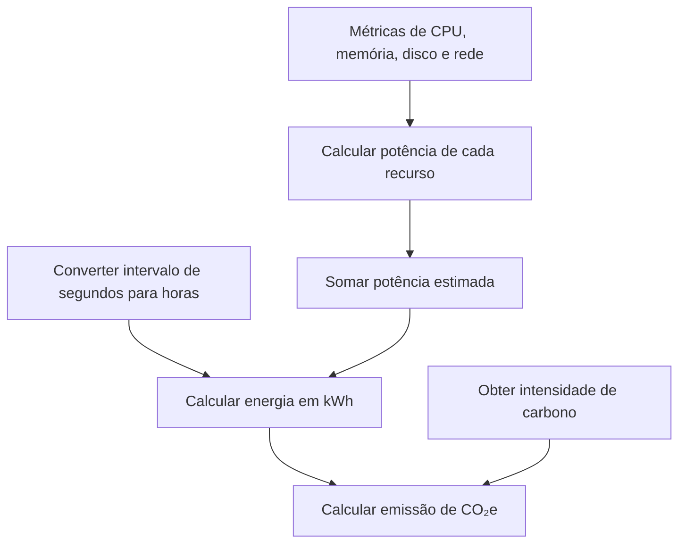

# Cálculos Ambientais — GreenER

Este documento reúne as fórmulas e o fluxo de cálculo ambiental descritos na
arquitetura. As responsabilidades do backend e a coordenação das coletas estão
em [../backend/arquitetura.md](../backend/arquitetura.md).

## Dados utilizados

As métricas de CPU, memória, disco e rede são obtidas da Greener Metrics
Aggregator API. O intervalo relacionado à coleta também é retornado junto das
métricas. A intensidade de carbono é obtida da Greener Carbon Intensity API
para a região do serviço.

O intervalo do Job, que define a frequência com que o backend inicia uma nova
rodada, não deve ser confundido com o intervalo recebido junto às métricas. O
intervalo das métricas é utilizado para calcular a energia daquela coleta.

## Potência estimada

A potência estimada é a soma das parcelas de CPU, memória, disco e rede:

```text
Potência Estimada (W) =
    Potência CPU
    + Potência Memória
    + Potência Disco
    + Potência Rede
```

### Potência da CPU

```text
Potência CPU (W) =
    (Uso de CPU (%) / 100)
    × Potência Máxima da CPU (W)
```

### Potência da memória

```text
Potência Memória (W) =
    Memória Utilizada (GB)
    × Fator de Consumo da Memória (W/GB)
```

### Potência de disco

```text
Potência Disco (W) =
    Uso de Disco (GB)
    × Fator de Consumo do Disco (W/GB)
```

### Potência de rede

```text
Potência Rede (W) =
    Tráfego de Rede (GB)
    × Fator de Consumo da Rede (W/GB)
```

Os valores numéricos da potência máxima da CPU e dos fatores de consumo não
estão definidos no documento de origem.

## Energia

O tempo de coleta, recebido em segundos, deve ser convertido para horas. A
energia é calculada a partir da potência estimada:

```text
Energia (kWh) =
    Potência Estimada (W)
    × Tempo de Coleta (h)
    / 1000
```

Exemplo de conversão de tempo:

```text
27 segundos / 3600 = 0,0075 horas
```

## Emissão estimada de CO₂e

A emissão é calculada multiplicando a energia pela intensidade de carbono da
região:

```text
CO₂e (g) =
    Energia (kWh)
    × Intensidade de Carbono (gCO₂e/kWh)
```

## Fluxo do cálculo

