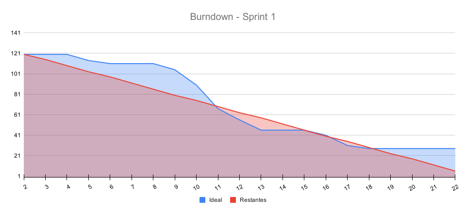

# 🚀 Sprint 1 — Planejamento e Acompanhamento

## Versão e leitura dos estados

Atualizado em 15/10/2026, código-base `41808d7` desta branch.
✅ na tabela representa tarefa implementada no seu escopo, não aceite automático
da história. Telas podem ter escopo visual concluído com mocks enquanto a
integração permanece pendente em T17. Review, retrospectiva e vídeo ainda
aguardam confirmação no encerramento de 19/10.

## 🎯 Sprint Goal

Entregar a primeira versão funcional do GreenER, capaz de consultar serviços e métricas por meio das APIs disponibilizadas pelo projeto, processar essas informações no backend, persistir as coletas, consultar o histórico e apresentá-las em uma interface web atualizada automaticamente, com toda a aplicação executando através de containers Docker.

---

## 📅 Período

- **Início:** 28/09/2026
- **Término:** 19/10/2026

---

## 👥 User Stories Contempladas

| ID | User Story |
|------|------|
| **US01** | Descoberta de serviços |
| **US03** | Coleta periódica de métricas |
| **US08** | Dashboard operacional |
| **US09** | Atualização automática do dashboard |

Estas são as quatro histórias selecionadas para a Sprint 1. Persistência e
histórico foram confirmados como entregas técnicas desta sprint; sua presença
no código não inclui automaticamente a US10 na seleção nem representa seu aceite. A
visualização geográfica permanece nesta entrega, vinculada à US08 e à issue #32,
com Gabriel em desenvolvimento. Autenticação fica na Sprint 3; configuração do
intervalo pela aplicação terá sua sprint definida posteriormente.

---

# Sprint Backlog — Sprint 1

| ID | Tarefa | Responsável | Status | Pontos | Requisito |
|---|---|---|:---:|:---:|---|
| **T01** | Definir e documentar a arquitetura do projeto | Henrique | ✅ | 5 | RNF08 |
| **T02** | Configurar estrutura inicial do backend | Pedro | ✅ | 2 | RF01 |
| **T03** | Implementar integração com o endpoint de descoberta de serviços | Vitor | ✅ | 5 | RF01 |
| **T04** | Criar modelo de representação dos serviços (DTO/Entidade) | Vitor/Pedro | ✅ | 3 | RF01 |
| **T05** | Implementar endpoint interno para disponibilizar os serviços ao frontend | Vitor | 🔄 | 5 | RF01 |
| **T06** | Implementar integração com o endpoint `/metrics/{id_servico}` | Pedro | ✅ | 5 | RF03 |
| **T07** | Implementar processamento das métricas recebidas | Pedro | ✅ | 5 | RF03 |
| **T08** | Implementar rotina periódica de coleta de métricas | Vitor | ✅ | 8 | RF03, RF11 |
| **T09** | Disponibilizar métricas processadas através do backend | Pedro | ✅ | 5 | RF03 |
| **T10** | Testar atualização periódica das métricas | Vitor | 🔄 | 2 | RF03 |
| **T11** | Definir layout inicial da aplicação | Paulo/Gabriel | ✅ | 3 | RF09 |
| **T12** | Desenvolver página inicial do GreenER | Gabriel | 🔄 | 5 | RF09 |
| **T13** | Desenvolver página de detalhamento de serviço | Paulo | ✅ | 5 | RF09 |
| **T14** | Criar componente de listagem dos serviços | Paulo | ✅ | 3 | RF09 |
| **T15** | Criar globo interativo, pins, inspeção regional e espaços de métricas (#32) | Gabriel | 🔄 | 3 | RF09, RF13 |
| **T16** | Implementar indicadores visuais de status dos serviços | Paulo/Gabriel | 🔄 | 3 | RF05, RF06, RF09 |
| **T17** | Integrar frontend com os endpoints do backend | Paulo/Gabriel | ❌ | 5 | RF09 |
| **T18** | Implementar atualização automática das informações exibidas | Paulo/Gabriel | ❌ | 8 | RF11, RNF02 |
| **T19** | Testar atualização automática dos dados sem recarregamento da página | Paulo/Gabriel | ❌ | 2 | RF11, RNF02 |
| **T20** | Preparar estrutura PostgreSQL utilizada na persistência e no histórico | Pedro | ✅ | 3 | RNF06 |
| **T21** | Configurar container PostgreSQL | Pedro | ✅ | 2 | RNF07 |
| **T22** | Configurar Docker do backend | Pedro | ✅ | 2 | RNF07 |
| **T23** | Configurar Docker do frontend | Pedro | ✅ | 2 | RNF07 |
| **T24** | Configurar Docker Compose do projeto | Pedro | ✅ | 5 | RNF07 |
| **T25** | Configurar ambiente de desenvolvimento compartilhado (Git, branches e fluxo de trabalho) | Pedro | ✅ | 3 | RNF09 |
| **T26** | Elaborar documentação inicial de execução do projeto | Henrique | ✅ | 3 | RNF08 |
| **T27** | Criar diagrama de casos de uso geral do sistema | Henrique | ✅ | 3 | RNF08 |
| **T28** | Criar diagrama de classes inicial do sistema | Henrique | ✅ | 5 | RNF08, RNF09 |
| **T29** | Criar diagramas de sequência iniciais do projeto | Henrique | ✅ | 5 | RNF08, RNF09 |
| **T30** | Documentar modelagem do banco (MER/DER) | Vitor | ✅ | 5 | RNF08, RNF09 |

## 📌 Legenda de Status

- ❌ Não iniciada
- 🔄 Em andamento
- ✅ Concluída

## 📊 Progresso da Sprint

- **Total:** 120 pontos
- **Concluídos:** 87 pontos
- **Em andamento:** 18 pontos
- **Não iniciados:** 15 pontos
- **Progresso Geral:** 72,50%

---

T04 e T14 passaram para implementadas com evidência de merge; T15 voltou a
em andamento para refletir o escopo atual da issue #32. T05 passou a em andamento
com trabalho publicado na branch #22, ainda não integrado. Os pontos originais
foram preservados; uma reestimativa do escopo do globo depende da equipe.
O resumo de esforço não é nota da rubrica nem percentual de histórias aceitas.

## 📈 Burndown da Sprint

    

---

O gráfico compara os dois estados documentados: 36 pontos não concluídos no
registro anterior e 33 na atualização de 15/10. Não reconstrói dias sem registros nem
atribui execução diária a partir da data do commit.

## Evidências e rastreabilidade

| Tarefa | Issue / PR | Evidência e estado conferido em 15/10 |
|---|---|---|
| T04 | [#21](https://github.com/Team-Zero-DSM/GreenER/issues/21), [PR #59](https://github.com/Team-Zero-DSM/GreenER/pull/59) | DiscoveredService e mapper integrados; issue permanece aberta. |
| T05 | [#22](https://github.com/Team-Zero-DSM/GreenER/issues/22), [commit 063d530](https://github.com/Team-Zero-DSM/GreenER/commit/063d530708ba93cf2c2d74d47b5fe8579bbe4513) | Trabalho publicado em branch própria, com alteração nas rotas e camadas de serviços; endpoint de lista ainda ausente na versão integrada aqui. |
| T07/T09 | [PR #52](https://github.com/Team-Zero-DSM/GreenER/pull/52), [PR #56](https://github.com/Team-Zero-DSM/GreenER/pull/56) | Cálculos, gravação, detalhe, histórico e monitoramento no backend. |
| T08 | [PR #51](https://github.com/Team-Zero-DSM/GreenER/pull/51) | Job integrado; novas rodadas após o término da anterior. |
| T10 | [#27](https://github.com/Team-Zero-DSM/GreenER/issues/27), [PR #55](https://github.com/Team-Zero-DSM/GreenER/pull/55) | PR aberto com proposta de testes; suíte não integrada nesta branch. |
| T11 | [PR #50](https://github.com/Team-Zero-DSM/GreenER/pull/50) | Protótipos desktop, tablet e mobile versionados. |
| T12/T15 | [#29](https://github.com/Team-Zero-DSM/GreenER/issues/29), [#32](https://github.com/Team-Zero-DSM/GreenER/issues/32) | Em desenvolvimento por Gabriel informado pela equipe; globo não integrado. |
| T13/T14 | [PR #53](https://github.com/Team-Zero-DSM/GreenER/pull/53), [PR #58](https://github.com/Team-Zero-DSM/GreenER/pull/58) | Detalhe e listagem visuais com mocks; issue #31 fechada e atribuída a Paulo. |
| T16 | [#33](https://github.com/Team-Zero-DSM/GreenER/issues/33) | Há ServiceStatusBadge no código; issue aberta e aceite final pendente. |
| T17 | [#35](https://github.com/Team-Zero-DSM/GreenER/issues/35) | Branch publicada sem commits próprios à frente da develop na comparação consultada; lista e detalhe desta versão continuam simulados. |
| T18/T19 | [#36](https://github.com/Team-Zero-DSM/GreenER/issues/36), [#37](https://github.com/Team-Zero-DSM/GreenER/issues/37) | Polling e validação ponta a ponta pendentes. |
| T20/T21 | [PR #41](https://github.com/Team-Zero-DSM/GreenER/pull/41), [PR #43](https://github.com/Team-Zero-DSM/GreenER/pull/43) | Schema e PostgreSQL com volume persistente integrados. |
| T01/T29 | [PR #54](https://github.com/Team-Zero-DSM/GreenER/pull/54), [PR #57](https://github.com/Team-Zero-DSM/GreenER/pull/57) | Arquiteturas e diagramas versionados; fluxos futuros identificados. |

No GitHub, #21, #32 e #33 ainda precisam de conferência de estado/responsável.
Esse registro não fecha issues nem altera atribuições remotas. A proposta de
testes do PR #55 e as branches #22/#35 não são tratadas como entregas integradas.

### Histórico e persistência na Sprint 1

O backend grava coletas e oferece GET /api/v1/service/:externalId/collections.
Essas implementações são entregas técnicas vinculadas ao trabalho de backend e
banco da sprint, com evidências em T07, T09 e T20. As histórias selecionadas
continuam sendo somente US01, US03, US08 e US09. A US10 permanece no Product
Backlog; não é declarada selecionada ou concluída por existir implementação
técnica relacionada. Integração da interface e retenção devem ser verificadas
no escopo das tarefas e dos critérios de aceite efetivamente selecionados.

## Verificações e Definition of Done

A [DoD geral](../../README.md) se aplica às histórias e, conforme o escopo, às
tarefas. A aplicação às **22 tarefas concluídas**, com procedimentos,
resultados observados e limites, está em
[Evidências da DoD](./evidencias-dod.md). O registro distingue inspeção de
artefatos, verificação em execução e funcionalidades ainda pendentes.
Não equivale a uma aprovação de todos os critérios da rubrica.

| Entrega | Evidência existente | Condição de aceite e limitação |
|---|---|---|
| Modelo de descoberta | PR #59 e verificação de runtime V04 da DoD. | Mapper conferido com opcionais presentes/ausentes; reconciliar checklist remoto da #21. |
| Listagem e detalhe visuais | PRs #53/#58 e verificações de navegador V07/V08. | Lista, busca, filtros, navegação, detalhe e período observados; mocks não comprovam T17 ou US08 concluída. |
| Detalhe HTTP | V02: 200 para existente, 404 para ausente e 400 para inválido. | Contrato conferido; consumo real pela interface pendente. |
| Histórico HTTP | V11: API comparada ao SQL; filtros válidos/inválidos exercitados em V02. | Contagem, energia e CO₂e coincidiram no mesmo período; integração da tela pendente. |
| Coleta periódica | V06: rodadas e horários de coleta avançaram com o processo ativo. | Recorrência observada; PR #55 continua como trabalho de testes em revisão. |
| Persistência | Repositories e volume no Compose. | Registrar retenção após reinicialização; volume declarado não é teste executado. |
| Atualização do dashboard | Contador demonstrativo existente. | Não atende atualização real; implementar e validar #36/#37. |

Procedimentos reproduzíveis estão no [README](../../README.md) e na
[documentação do banco](../../database/arquitetura.md). Resultados de uma
verificação anterior não garantem sucesso após novos commits.

### Resultados das verificações de 15/10/2026

Execução em 15/10/2026, nos containers existentes montados nesta branch:

| Verificação | Resultado observado |
|---|---|
| `docker compose ps` | Três serviços ativos; backend e PostgreSQL saudáveis. |
| `docker compose config --quiet` | Configuração válida. |
| TypeScript com `--noEmit`, backend e frontend | Sem erros. |
| `npm run lint`, backend e frontend | Sem erros. |
| `GET /health` | HTTP 200. |
| `GET /api/v1/service/billing-api` | HTTP 200. |
| `GET /api/v1/service/unknown-service-review` | HTTP 404. |
| `GET /api/v1/service/a%20b` | HTTP 400. |
| Histórico com `range=1h&maxPoints=3` | HTTP 200. |
| Histórico com `range=invalid` | HTTP 400. |
| `GET /api/v1/monitoring/status` | HTTP 200. |
| `GET /api/v1/services` | HTTP 404; confirma dependência da listagem real. |

Foram conferidos também links locais, âncoras, matrizes obrigatórias por sprint,
soma dos pontos e estrutura XML do gráfico. O DDL foi executado sem erro
em banco vazio descartável e os totais históricos foram comparados com SQL.
A aplicação da DoD acrescentou verificações de mapper, cálculos, recorrência e
navegação visual, detalhadas no [registro de evidências](./evidencias-dod.md).
Não foram executados clone limpo, reinicialização do banco do projeto para
retenção, suíte proposta no PR #55 ou validação ponta a ponta com dados reais.
Não equivalem a uma Sprint Review ou aceite formal da equipe.

## Participação da equipe

| Integrante | Contribuições verificáveis | Referências |
|---|---|---|
| Henrique | Arquitetura, diagramas, planejamento e registros. | PRs #54/#57 e [dailies](./dailies.md). |
| Paulo | Detalhe, listagem, filtros, layout e gráficos. | PRs #53/#58. |
| Gabriel | Protótipos; página inicial e globo em desenvolvimento. | PR #50, issues #29/#32 e informação da equipe sobre o globo. |
| Pedro | Infraestrutura, integração, processamento, persistência e rotas. | PRs #41/#43/#48/#52/#56. |
| Vitor | Descoberta, job, modelo e proposta de testes. | PRs #47/#51/#59/#55; PR #55 aberto. |

As referências são links para artefatos, não uma avaliação por quantidade de commits.

## 🔎 Sprint Review

Registro pendente de encerramento. Preencher com os resultados da reunião:

- Data, participantes e commit apresentado: [PREENCHER].
- Entregas demonstradas e critérios verificados: [PREENCHER].
- Pendências, motivos e impacto: [PREENCHER].
- Feedback recebido, origem e decisões da equipe: [PREENCHER].
- Alterações no backlog, responsáveis e sprint de destino: [PREENCHER].

---

## 🔄 Sprint Retrospective

### O que funcionou?

> A ser preenchido ao final da Sprint.

### O que não funcionou?

> A ser preenchido ao final da Sprint.

### O que melhorar na próxima Sprint?

> A ser preenchido ao final da Sprint.

---

## 🎥 Demonstração da Sprint

Link da apresentação ou vídeo e versão demonstrada: [PREENCHER após a gravação].
