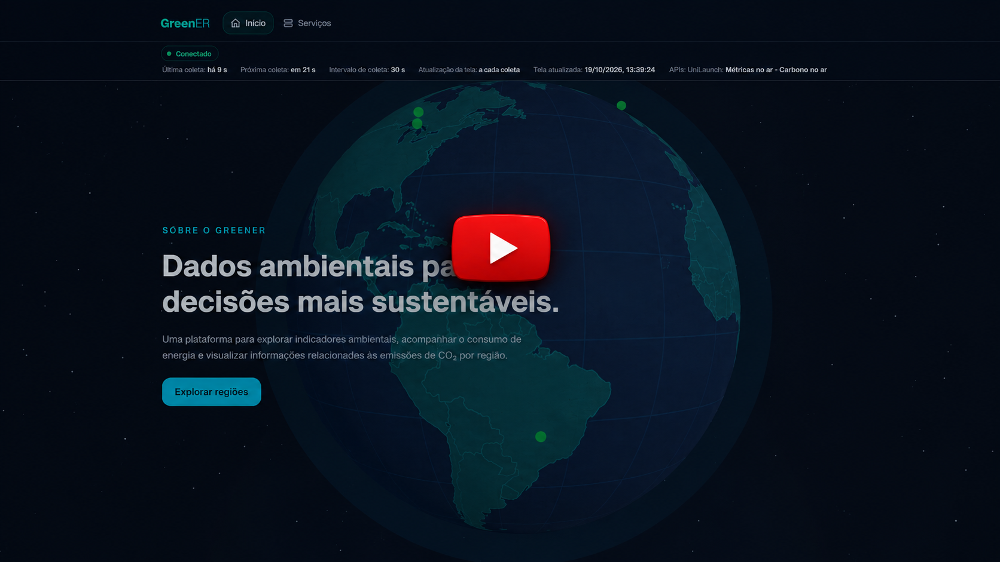

# 🚀 Sprint 1 — Planejamento e Acompanhamento

## Leitura dos estados

✅ representa implementação no escopo da tarefa; aceite da história depende dos
critérios e das [evidências da DoD](./evidencias-dod.md). Lista, detalhe, histórico
e atualização automática usam dados reais. A parte restante de T15 foi transferida
para a Sprint 2: ao inspecionar uma região, apresentar seus serviços associados.
Review, retrospectiva e vídeo aguardam o encerramento de 19/10.

## 🎯 Sprint Goal

Entregar a primeira versão funcional do GreenER, capaz de consultar serviços e métricas por meio das APIs disponibilizadas pelo projeto, processar essas informações no backend, persistir as coletas, consultar o histórico e apresentá-las em uma interface web atualizada automaticamente, com toda a aplicação executando através de containers Docker.

---

## 📅 Período

- **Início:** 28/09/2026
- **Término:** 19/10/2026

---

## 👥 User Stories Contempladas

| ID | User Story | Relação com a sprint |
|---|---|---|
| **US01** | Descoberta de serviços | Selecionada no planejamento |
| **US02** | Monitoramento dinâmico dos serviços | Cobertura identificada durante o desenvolvimento |
| **US03** | Coleta periódica de métricas | Selecionada no planejamento |
| **US06** | Cálculo do impacto individual | Cobertura identificada durante o desenvolvimento |
| **US08** | Dashboard operacional | Selecionada no planejamento; parcialmente entregue |
| **US09** | Atualização automática do dashboard | Selecionada no planejamento |
| **US10** | Consulta do histórico de coletas | Cobertura identificada durante o desenvolvimento |
| **US11** | Visualização da localização dos serviços | Cobertura identificada durante o desenvolvimento |
| **US12** | Visualização geográfica dos serviços | Cobertura identificada durante o desenvolvimento |

São **nove histórias contempladas pela entrega: oito com implementação presente
e a US08 parcialmente entregue**. A seleção original do planejamento foi US01,
US03, US08 e US09; as outras cinco histórias tiveram sua cobertura identificada
nas funcionalidades desenvolvidas. Essa distinção preserva o planejamento
original e não presume uma decisão formal de acréscimo de escopo.

Implementação presente não equivale ao aceite da história. A US02 ainda exige
validação completa das transições de descoberta, ausência e restabelecimento;
as demais ressalvas e o aceite pendente estão registrados na
[matriz de histórias e tarefas do README](../../README.md#rastreabilidade-das-oito-histórias-implementadas).

Persistência e histórico foram entregas técnicas desta sprint. A visualização
geográfica possui globo integrado, vinculado à US08 e à issue #32. Por decisão
da equipe, apresentar os serviços associados ao inspecionar uma região fica
para a Sprint 2, como continuação de T15, sob responsabilidade de Gabriel.
Autenticação fica na Sprint 3; configuração do intervalo pela aplicação terá
sua sprint definida posteriormente.

---

## 📋 Sprint Backlog — Sprint 1

| ID | Tarefa | Responsável | Status | Pontos | Requisito |
|---|---|---|---|---:|---|
| **T01** | Definir e documentar a arquitetura do projeto | henrique | ✅ | 5 | RNF08 |
| **T02** | Configurar estrutura inicial do backend | pedro | ✅ | 2 | RF01 |
| **T03** | Implementar integração com endpoint de descoberta de serviços | vitor | ✅ | 5 | RF01 |
| **T04** | Criar modelo de representação dos serviços (DTO/Entidade) | vitor/pedro | ✅ | 3 | RF01 |
| **T05** | Implementar endpoint interno para disponibilizar serviços ao frontend | vitor | ✅ | 5 | RF01 |
| **T06** | Integrar `/metrics/{id_servico}` | pedro | ✅ | 5 | RF03 |
| **T07** | Processar métricas recebidas | pedro | ✅ | 5 | RF03 |
| **T08** | Rotina periódica de coleta | vitor | ✅ | 8 | RF03, RF11 |
| **T09** | Disponibilizar métricas processadas pelo backend | pedro | ✅ | 5 | RF03 |
| **T10** | Testar atualização periódica | vitor | ✅ | 2 | RF03 |
| **T11** | Layout inicial da aplicação | paulo/gabriel | ✅ | 3 | RF09 |
| **T12** | Página inicial GreenER | gabriel | ✅ | 5 | RF09 |
| **T13** | Página de detalhamento de serviço | paulo | ✅ | 5 | RF09 |
| **T14** | Componente de listagem dos serviços | paulo | ✅ | 3 | RF09 |
| **T15** | Criar componente de visualização das métricas | gabriel | ➡️ | 3 | RF09 |
| **T16** | Indicadores visuais de status | paulo/gabriel | ✅ | 3 | RF05, RF06, RF09 |
| **T17** | Integrar frontend com endpoints backend | paulo/gabriel | ✅ | 5 | RF09 |
| **T18** | Atualização automática das informações exibidas | paulo/gabriel | ✅ | 8 | RF11, RNF02 |
| **T19** | Testar atualização automática sem recarregar | paulo/gabriel | ✅ | 2 | RF11, RNF02 |
| **T20** | Preparar estrutura inicial PostgreSQL para futuras funcionalidades | pedro | ✅ | 3 | RNF06 |
| **T21** | Configurar container PostgreSQL | pedro | ✅ | 2 | RNF07 |
| **T22** | Configurar Docker backend | pedro | ✅ | 2 | RNF07 |
| **T23** | Configurar Docker frontend | pedro | ✅ | 2 | RNF07 |
| **T24** | Configurar Docker Compose | pedro | ✅ | 5 | RNF07 |
| **T25** | Ambiente de desenvolvimento compartilhado | pedro | ✅ | 3 | RNF09 |
| **T26** | Documentação inicial de execução | henrique | ✅ | 3 | RNF08 |
| **T27** | Diagrama de casos de uso geral | henrique | ✅ | 3 | RNF08 |
| **T28** | Diagrama de classes inicial | henrique | ✅ | 5 | RNF08, RNF09 |
| **T29** | Diagramas de sequência iniciais | henrique | ✅ | 5 | RNF08, RNF09 |
| **T30** | Modelagem do banco MER/DER | vitor | ✅ | 5 | RNF08, RNF09 |

## 📌 Legenda de Status
- ❌ Não iniciada
- 🔄 Em andamento
- ➡️ Parcialmente implementada; saldo transferido para a Sprint 2
- ✅ Concluída

## 📊 Progresso da Sprint
- Total: 120 pontos
- Concluídos: 117 pontos
- Transferidos para a Sprint 2: 3 pontos de T15, sem contabilizar conclusão parcial
- Em andamento nesta sprint: 0 pontos
- Não iniciados: 0 pontos
- Progresso sobre o compromisso original: 97,50%

O compromisso original de 120 pontos foi preservado. A transferência de T15 não
transforma os 3 pontos restantes em entrega concluída nem implica aceite integral
da US08. O burndown deve preservar esse saldo; a decisão não altera retroativamente
os registros diários.

---

## 📈 Burndown da Sprint

    

---

## Evidências e rastreabilidade

A tabela abaixo relaciona as tarefas às **nove histórias contempladas pela
entrega da Sprint 1**: US01, US02, US03, US06, US08, US09, US10, US11 e US12.
A US08 permanece parcialmente entregue, com o saldo de T15 na Sprint 2.

A [matriz de histórias e tarefas no README](../../README.md#rastreabilidade-das-oito-histórias-implementadas)
detalha o código, as evidências e as ressalvas das outras oito histórias, que
possuem implementação presente. O aceite formal permanece pendente, incluindo
a validação completa das transições da US02.

| Entrega / requisitos | Tarefas | Implementação e evidências |
|---|---|---|
| Descoberta — US01, RF01 | T02–T05 | [Services](../../backend/src/modules/services/), [integrações](../../backend/src/integrations/); PRs [#59](https://github.com/Team-Zero-DSM/GreenER/pull/59) e [#61](https://github.com/Team-Zero-DSM/GreenER/pull/61). |
| Monitoramento dinâmico — US02, RF02/RNF10 | T03, T08, T16–T17 | [Sincronização, status e coleta](../../backend/src/modules/collections/collections.service.ts), [persistência dos estados](../../backend/src/modules/collections/collections.repository.ts), [job](../../backend/src/jobs/collections.job.ts). Validação completa das transições pendente. |
| Coleta e métricas — US03, RF03/RF11 | T06–T10 | [Collections](../../backend/src/modules/collections/), [job](../../backend/src/jobs/collections.job.ts); PR [#55](https://github.com/Team-Zero-DSM/GreenER/pull/55). |
| Impacto individual — US06, RF07 | T07, T09, T13, T17 | [Cálculos ambientais](../../backend/src/modules/collections/collections.service.ts), [detalhe real](../../frontend/src/pages/ServiceDetailPage.tsx), [fórmulas](../cálculo.md); reprocessamento V05 no [registro da DoD](./evidencias-dod.md). |
| Interface — US08, RF09 | T11–T17 | [Páginas](../../frontend/src/pages/), [globo](../../frontend/src/components/3d/GlobeView.tsx); PRs [#60](https://github.com/Team-Zero-DSM/GreenER/pull/60), [#63](https://github.com/Team-Zero-DSM/GreenER/pull/63) e [#64](https://github.com/Team-Zero-DSM/GreenER/pull/64). T15 conserva saldo para a Sprint 2. |
| Atualização — US09, RF11 | T18–T19 | [Provider](../../frontend/src/contexts/MonitoringProvider.tsx), [consultas](../../frontend/src/hooks/useApiQuery.ts); PR [#65](https://github.com/Team-Zero-DSM/GreenER/pull/65). |
| Histórico de coletas — US10, RF10/RNF06 | T07, T09, T13, T17, T20–T21, T30 | [Gravação](../../backend/src/modules/collections/collections.repository.ts), [analytics](../../backend/src/modules/analytics/), [gráficos e período](../../frontend/src/pages/ServiceDetailPage.tsx); conferência HTTP × SQL em V11 no [registro da DoD](./evidencias-dod.md). |
| Localização dos serviços — US11, RF12 | T04–T05, T13–T14, T17 | [Mapper](../../backend/src/integrations/metrics-api.mapper.ts), [serviços e localização](../../backend/src/modules/services/services.repository.ts), [detalhe](../../frontend/src/pages/ServiceDetailPage.tsx). |
| Visualização geográfica — US12, RF13 | T04–T05, T12, parcela de T15, T17 | [Marcadores com coordenadas reais](../../frontend/src/pages/LandingPage.tsx), [globo](../../frontend/src/components/3d/GlobeView.tsx). Esta parcela não conclui a inspeção regional pendente de T15. |
| Persistência e infraestrutura — RNF06/RNF07 | T20–T25, T30 | [Schema](../../database/schema.sql), [Compose](../../docker-compose.yml), [banco](../../database/arquitetura.md). |
| Documentação e modelagem — RNF08/RNF09 | T01, T26–T29 | [Arquitetura](../arquitetura/arquitetura.md), [protótipos](../prototipo/prototipo.md), [plano](../plano-de-entregas.md). |

## Participação da equipe

| Integrante | Contribuições rastreáveis |
|---|---|
| Henrique | Arquitetura, documentação e diagramas: T01, T26–T29; [histórico](https://github.com/Team-Zero-DSM/GreenER/commits/). |
| Pedro | Backend, processamento, histórico e Docker: T02, T04, T06–T09, T20–T25; módulos e Compose vinculados acima. |
| Vitor | Descoberta, listagem, rotina, testes e modelagem: T03–T05, T08, T10, T30; PRs #55, #59 e #61. |
| Paulo | Detalhe, listagem, status e atualização: T11, T13–T14, T16–T19; PRs #64 e #65. |
| Gabriel | Layout, página inicial, globo e integração: T11–T12, T15–T19; PRs #60 e #63. Continuação de T15 na Sprint 2. |

As contribuições são verificáveis nos artefatos e no histórico; esta tabela não
substitui presença nas cerimônias, feedback ou aceite formal.

## Verificações e Definition of Done

Resultados, procedimentos e limites estão no [registro de evidências](./evidencias-dod.md).
As verificações distinguem os resultados anteriores à integração dos resultados
da aplicação integrada.
Persistência após reinicialização, aceite final das histórias e encerramento da
sprint permanecem pendentes até seus respectivos registros.

## 🔎 Sprint Review

> Nesta primeira Sprint, nosso foco foi desenvolver a base funcional do GreenER, implementando a coleta periódica de métricas, a integração entre backend e frontend e a consulta de informações dos serviços e regiões. Ao longo do desenvolvimento, conseguimos estruturar os principais componentes da aplicação e entregar uma primeira versão funcional, permitindo consultar os serviços monitorados e acompanhar estimativas de consumo energético e emissões de CO₂ equivalente. Apesar dos desafios iniciais com as tecnologias e ferramentas utilizadas, a equipe conseguiu superar os principais impedimentos e alcançar os objetivos centrais da Sprint. Para as próximas etapas, planejamos aprimorar a interface, expandir as formas de visualização dos dados e melhorar a integração e a eficiência do sistema.

---

## 🔄 Sprint Retrospective

### O que funcionou?

> A equipe teve uma boa introdução ao projeto e conseguiu evoluir bastante durante a Sprint, trabalhando de forma colaborativa, cumprindo os principais prazos e superando os impedimentos encontrados. O GitHub Projects, o Docker e o GitHub Actions também contribuíram para a organização, a automação e a integração do trabalho, permitindo alcançar o principal objetivo planejado.

### O que não funcionou?

> Apesar do bom andamento geral, tivemos algumas dificuldades na divisão das tasks e na adaptação às novas tecnologias e ferramentas utilizadas. Em alguns momentos, surgiram atividades que não estavam previstas no planejamento, e a documentação nem sempre correspondia ao que precisava ser implementado na prática, exigindo ajustes ao longo do desenvolvimento.

### O que melhorar na próxima Sprint?

> Manter o ritmo de trabalho e a organização que tivemos, aproveitando os conhecimentos adquiridos nesta primeira Sprint para melhorar o planejamento e dividir as tasks em atividades menores e mais claras. Com a experiência adquirida no uso das ferramentas, das classes, das APIs externas e dos processos de desenvolvimento, podemos padronizar melhor o trabalho e reaproveitar o que funcionou para evoluir as demais partes do projeto.

---

## 🎥 Demonstração da Sprint

Link da apresentação da sprint: 

  

