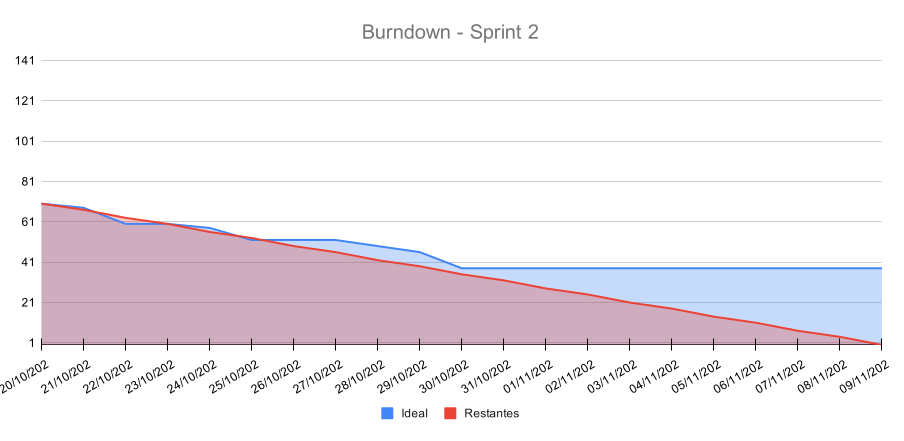

# 🚀 Sprint 2 — Entregas e Acompanhamento

## Situação da entrega

Todas as 28 tarefas propostas nesta página foram concluídas, conforme informado
pela equipe. A consulta ao GitHub em **06/11/2026** confirma o fechamento das
tarefas do milestone e das seis histórias selecionadas. O saldo da inspeção
regional associado à #32 foi entregue nesta sprint.

Os pontos foram conferidos no campo **Estimate** do
[GitHub Projects — GreenER-ABP2](https://github.com/orgs/Team-Zero-DSM/projects/3).
Quando o campo estava vazio, foi preservada a estimativa do planejamento local;
a origem está detalhada no [registro de evidências](./evidencias-dod.md).

## 🎯 Sprint Goal

O objetivo é ampliar a análise ambiental com rankings e comparação entre
serviços, registrar falhas e recuperação das coletas e evoluir o dashboard e as
visualizações regionais.

---

## 📅 Período

- **Início:** 20/10/2026
- **Término:** 09/11/2026

---

## 👥 User Stories Contempladas

| ID | User Story | Relação com a sprint |
|---|---|---|
| **US04** | Identificação de indisponibilidade | Concluída nesta sprint |
| **US05** | Identificação de ausência de métricas | Concluída nesta sprint |
| **US07** | Indicadores ambientais consolidados | Concluída nesta sprint |
| **US08** | Dashboard operacional | Continuidade da Sprint 1; concluída nesta sprint |
| **US13** | Ranking de impacto | Concluída nesta sprint |
| **US14** | Comparação entre serviços | Concluída nesta sprint |

---

## 📋 Sprint Backlog — Sprint 2

| ID | Tarefa | Responsável | Status | Pontos |
|---|---|---|:---:|---:|
| **T01** | Implementar componentes e interações da comparação (#83) | henrique | ✅ | 8 |
| **T02** | Implementação da listagem de serviços e integração com o globo na landing page (#80) | gabriel | ✅ | 8 |
| **T03** | Criar componente de visualização das métricas (#32) | gabriel | ✅ | 3 |
| **T04** | Criar componente para exibição das regiões (#97) | vitor | ✅ | 3 |
| **T05** | Criar componente para exibição de carbono por região (#98) | vitor | ✅ | 3 |
| **T06** | Criar componente para exibição do mapa 2D com as regiões (#99) | vitor | ✅ | 8 |
| **T07** | Criar estrutura da tela de ranking (#102) | paulo | ✅ | 3 |
| **T08** | Implementar filtros de critério e período do ranking (#103) | paulo | ✅ | 3 |
| **T09** | Integrar a tela de ranking ao backend (#104) | paulo | ✅ | 5 |
| **T10** | Implementar gráfico de barras do ranking (#105) | paulo | ✅ | 5 |
| **T11** | Implementar tabela de classificação do ranking (#106) | paulo | ✅ | 3 |
| **T12** | Atualizar diagrama de casos de uso (#77) | henrique | ✅ | 2 |
| **T13** | Elaborar diagramas de sequência (#78) | henrique | ✅ | 5 |
| **T14** | Criar estrutura da tela de comparação (#82) | henrique | ✅ | 2 |
| **T15** | Criar tabela de histórico de status das coletas (#89) | pedro | ✅ | 3 |
| **T16** | Implementar registro do histórico de status das coletas (#90) | pedro | ✅ | 3 |
| **T17** | Criar componente de visualização das métricas (#63) | gabriel | ✅ | 3 |
| **T18** | Implementação das funcionalidades do globo (#79) | gabriel | ✅ | 8 |
| **T19** | Atualização da Header do projeto (#81) | gabriel | ✅ | 3 |
| **T20** | Integrar a tela de comparação ao backend (#84) | henrique | ✅ | 5 |
| **T21** | Implementar a visualização dos resultados comparativos (#85) | henrique | ✅ | 5 |
| **T22** | Implementar cálculos e resumo comparativo (#86) | henrique | ✅ | 2 |
| **T23** | Criar endpoint para consultar o histórico de status das coletas (#91) | pedro | ✅ | 5 |
| **T24** | Criar endpoints para a tela de ranking (#92) | pedro | ✅ | 5 |
| **T25** | Criar endpoints para a tela de comparação entre serviços (#93) | pedro | ✅ | 8 |
| **T26** | Validar endpoint de serviços por região (#94) | Vitor | ✅ | 2 |
| **T27** | Realizar testes das funcionalidades do backend (#95) | pedro | ✅ | 5 |
| **T28** | Atualizar documentação do backend e do banco de dados (#96) | pedro | ✅ | 3 |

**Resultado: 28 de 28 tarefas concluídas (100%), totalizando 121 pontos.** Os pontos e responsáveis
estão consolidados no [backlog por issue](./evidencias-dod.md#sprint-backlog).
Os valores zerados foram substituídos pelas estimativas encontradas no Projects.
A #63 foi mantida como tarefa de apoio já prevista nesta página, sem alterar
o registro da Sprint 1.

---

## 📈 Burndown da Sprint

    

---

## Evidências e rastreabilidade

| História | Tarefas vinculadas | Entrega concluída |
|---|---|---|
| US04 e US05 | #89–#91 | Tabela, registro e consulta do histórico de falhas e recuperação das coletas. PRs #101, #107 e #108. |
| US07 | #75; contribuição regional de #97 | História de indicadores consolidados fechada no GitHub. Cards regionais integram a entrega do dashboard. |
| US08 | #32, #79–#81, #94 e #97–#99 | Inspeção de serviços por região, globo e mapa 2D, listagem, navegação e indicadores regionais. PRs #110, #115, #118, #120, #124, #125 e #128. |
| US13 | #92 e #102–#106 | Ranking integrado ao backend, filtros de critério e período, gráfico e tabela de classificação. PRs #109, #112, #114, #116 e #126. |
| US14 | #82–#86 e #93 | Comparação integrada ao backend, seleção de serviços, visualização, cálculos e resumo comparativo. PRs #100, #111, #113, #121, #123 e #129. |

Documentação e validação do backend foram concluídas nas tarefas #95 e #96,
vinculadas aos PRs #127 e #130. Diagramas foram atualizados em #77 e #78,
com os PRs #87 e #88.

Consulte o [registro de evidências](./evidencias-dod.md#evidências-e-limites-de-conclusão)
para as fontes e o alcance desta atualização documental.

## Participação da equipe

| Integrante | Presença nas sete dailies registradas | Atividades registradas |
|---|---:|---|
| Henrique | 7 | Diagramas de casos de uso e sequência. Planejamento da integração da comparação. |
| Paulo | 5 | Desenvolvimento e entrega da estrutura da página de ranking. |
| Gabriel | 5 | Visualização das métricas e ajustes da página inicial. |
| Pedro | 7 | Planejamento dos endpoints e entrega do histórico de status de coleta. |
| Vitor | 7 | Tags da tela de regiões e ajustes para dispositivos móveis e tablets. |

A contagem cobre os registros de 20 a 28/10. O planejamento em equipe de 20/10
e o ajuste a partir do feedback do cliente em 21/10 também estão nas [dailies](./dailies.md).

## Verificações e Definition of Done

| Critério | Resultado registrado |
|---|---|
| Tarefas propostas | Todas concluídas; estados atualizados no backlog. |
| Rastreabilidade | Histórias, tarefas e PRs relacionados no registro de evidências. |
| Integração | Entregas de histórico, ranking, comparação e regiões integradas. |
| Validação do backend | #94 e #95 fechadas, com PRs #128 e #127. |
| Documentação | #96 fechada, com PR #130; diagramas entregues em #77 e #78. |

Esta atualização registra a conclusão informada pela equipe e os estados
consultados no GitHub. Não representa uma nova execução de testes nem uma ata
de homologação do cliente.

## 🔎 Sprint Review

O escopo proposto foi entregue: histórico de status das coletas, ranking de
impacto ambiental, comparação entre serviços e ampliação do dashboard e das
visualizações regionais. As integrações com o backend, os testes previstos e a
documentação também foram concluídos.

As seis histórias selecionadas (US04, US05, US07, US08, US13 e US14) estão
fechadas no GitHub. A inspeção dos serviços por região associada à #32 foi
concluída nesta sprint. O período planejado permanece de 20/10 a 09/11/2026;
a situação acima foi consolidada em 06/11/2026.

Feedback da apresentação e aceite formal do cliente: sem registro disponível
para esta atualização.

---

## 🔄 Sprint Retrospective

### O que funcionou?

> Preencher ao final da sprint

### O que não funcionou?

> Preencher ao final da sprint

### O que melhorar na próxima Sprint?

> Preencher ao final da sprint

---

## 🎥 Demonstração da Sprint

Link da apresentação da sprint: 

> Preencher ao final da sprint
