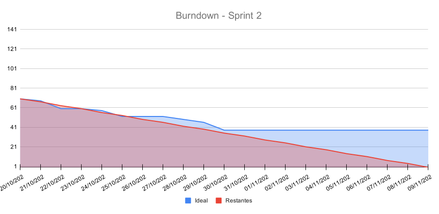

# 🚀 Sprint 1 — Planejamento e Acompanhamento

## Leitura dos estados

✅ representa implementação no escopo da tarefa; aceite da história depende dos
critérios e das [evidências da DoD](./evidencias-dod.md). Lista, detalhe, histórico
e atualização automática usam dados reais. A parte restante de T15 foi transferida
para a Sprint 2: ao inspecionar uma região, apresentar seus serviços associados.
Review, retrospectiva e vídeo aguardam o encerramento de 09/11.

## 🎯 Sprint Goal

O objetivo é ampliar a análise ambiental com rankings e comparação entre
serviços, registrar falhas e recuperação das coletas e evoluir o dashboard e as
visualizações regionais.

---

## 📅 Período

- **Início:** 20/10/2026
- **Término:** 09/11/2026

---

## 👥 User Stories Contempladas

| ID | User Story | Relação com a sprint |
|---|---|---|
| **US04** | Identificação de indisponibilidade | Selecionada no planejamento |
| **US05** | Identificação de ausência de métricas | Selecionada no planejamento |
| **US07** | Indicadores ambientais consolidados | Selecionada no planejamento |
| **US08** | Dashboard operacional | Continuidade da Sprint 1; parcialmente entregue |
| **US13** | Ranking de impacto | Selecionada no planejamento |
| **US14** | Comparação entre serviços | Selecionada no planejamento |

---

## 📋 Sprint Backlog — Sprint 2

| ID | Tarefa | Responsável | Status | Pontos |
|---|---|---|:---:|---:|
| **T01** | Implementar componentes e interações da comparação | henrique | ✅ | 8 |
| **T02** | Implementação da listagem de serviços e integração com o globo na landing page | gabriel | ❌ | 8 |
| **T03** | Criar componente de visualização das métricas | gabriel | ❌ | 3 |
| **T04** | Criar componente para exibição das regiões | vitor | ✅ | 3 |
| **T05** | Criar componente para exibição de carbono por região | gabriel | ❌ | 3 |
| **T06** | Criar componente para exibição do mapa 2D com as regiões | gabriel | ❌ | 8 |
| **T07** | Criar estrutura da tela de ranking | paulo | ✅ | 3 |
| **T08** | Implementar filtros de critério e período do ranking | paulo | ❌ | 3 |
| **T09** | Integrar a tela de ranking ao backend | paulo | ❌ | 5 |
| **T10** | Implementar gráfico de barras do ranking | paulo | ❌ | 5 |
| **T11** | Implementar tabela de classificação do ranking | paulo | ❌ | 3 |
| **T12** | Atualizar diagrama de casos de uso | henrique | ✅ | 2 |
| **T13** | Elaborar diagramas de sequência | henrique | ✅ | 5 |
| **T14** | Criar estrutura da tela de comparação | henrique | ✅ | 2 |
| **T15** | Criar tabela de histórico de status das coletas | pedro | ✅ | 3 |
| **T16** | Implementar registro do histórico de status das coletas | pedro | ✅ | 3 |
| **T17** | Criar componente de visualização das métricas | gabriel | ✅ | 3 |

## 📌 Legenda de Status
- ❌ Não iniciada
- 🔄 Em andamento
- ➡️ Parcialmente implementada; saldo transferido para a Sprint 2
- ✅ Concluída

---

## 📈 Burndown da Sprint

    

---

## Evidências e rastreabilidade

> A preencher

## Participação da equipe

> A preencher

As contribuições são verificáveis nos artefatos e no histórico; esta tabela não
substitui presença nas cerimônias, feedback ou aceite formal.

## Verificações e Definition of Done

> A preencher

## 🔎 Sprint Review

> Preencher ao final da sprint

---

## 🔄 Sprint Retrospective

### O que funcionou?

> Preencher ao final da sprint

### O que não funcionou?

> Preencher ao final da sprint

### O que melhorar na próxima Sprint?

> Preencher ao final da sprint

---

## 🎥 Demonstração da Sprint

Link da apresentação da sprint: 

> Preencher ao final da sprint
